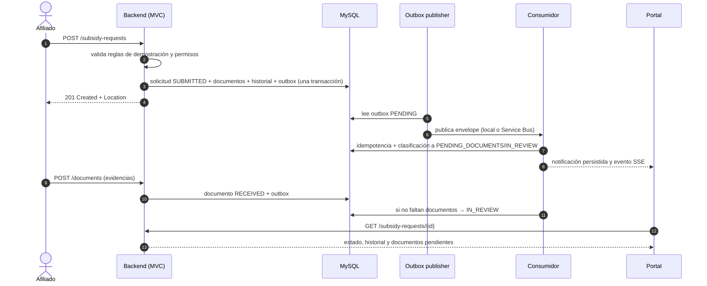
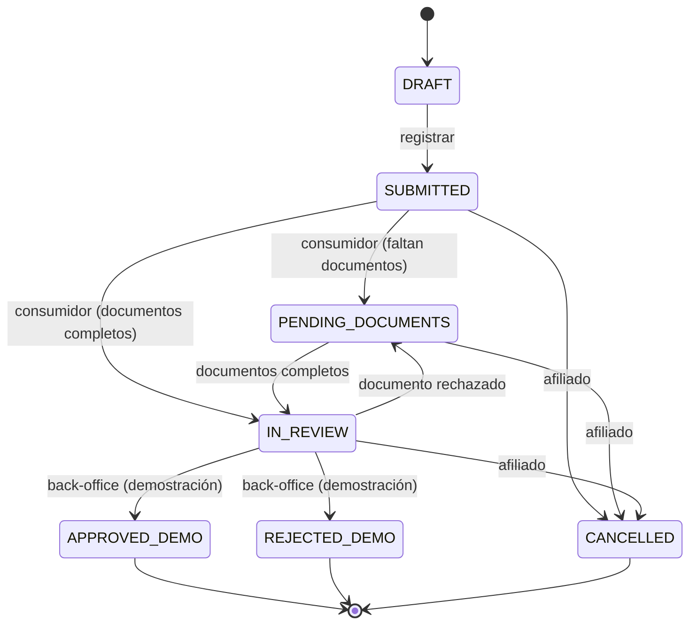

# 02 · Requisitos funcionales

## Convenciones

- **Prioridad**: `M` (must, imprescindible para la demo), `S` (should, esperado en una entrega sénior),
  `C` (could, deseable si el tiempo lo permite).
- **Criterio de aceptación**: condición verificable, preferiblemente automatizable con una prueba.
- Los identificadores son estables y se usan en la [matriz de trazabilidad](05-trazabilidad.md).

## 2.1 Autenticación y sesión

| ID | Requisito | Prioridad | Criterio de aceptación |
|----|-----------|-----------|------------------------|
| FR-AUT-01 | Emitir un JWT de demostración con usuario y contraseña | M | `POST /api/v1/auth/demo-token` con credenciales válidas devuelve 200, `accessToken`, `tokenType=Bearer`, `expiresIn`, `roles`, `affiliateId`/`companyId` cuando aplique |
| FR-AUT-02 | Rechazar credenciales inválidas sin filtrar información | M | Credenciales erróneas devuelven 401 con `application/problem+json` y `code=UNAUTHENTICATED`; no se distingue usuario inexistente de contraseña incorrecta |
| FR-AUT-03 | Proteger todos los endpoints de negocio | M | Sin token, cualquier `/api/v1/**` distinto del token endpoint devuelve 401 |
| FR-AUT-04 | Autorizar por rol | M | Un `ROLE_AFFILIATE` que llama un endpoint de back-office recibe 403 |
| FR-AUT-05 | Autorizar por recurso (ownership) | M | Un afiliado que solicita el detalle de otro afiliado o de una solicitud ajena recibe 403, aunque su rol sea correcto |
| FR-AUT-06 | Exponer la identidad efectiva | S | `GET /api/v1/auth/me` devuelve sujeto, roles, `affiliateId`, `companyId` y expiración del token |
| FR-AUT-07 | Registrar intentos de autenticación | S | Cada intento fallido y exitoso queda en `audit_log` con actor, acción y correlación |

## 2.2 Portal de afiliados

| ID | Requisito | Prioridad | Criterio de aceptación |
|----|-----------|-----------|------------------------|
| FR-AFI-01 | Consultar el perfil del afiliado autenticado | M | `GET /api/v1/affiliates/me` devuelve nombre, tipo y número de documento enmascarado, categoría, estado, empresa y fechas |
| FR-AFI-02 | Actualizar datos de contacto propios | S | `PATCH /api/v1/affiliates/me/contact` valida formato de correo y teléfono, persiste y registra auditoría |
| FR-AFI-03 | Consultar beneficiarios | M | `GET /api/v1/affiliates/me/beneficiaries` devuelve la lista ordenada; documentos enmascarados; un afiliado no puede consultar los de otro |
| FR-AFI-04 | Consultar solicitudes propias con filtro por estado y paginación | M | `GET /api/v1/affiliates/me/subsidy-requests?status=&page=&size=` devuelve sólo solicitudes del afiliado, con metadatos de paginación |
| FR-AFI-05 | Consultar el detalle de una solicitud con documentos e historial | M | El detalle incluye estado, monto, fechas, documentos requeridos con estado y la línea de tiempo de cambios |
| FR-AFI-06 | Consultar requisitos y documentos pendientes | M | El detalle indica explícitamente cuántos y cuáles documentos están pendientes o rechazados |
| FR-AFI-07 | Consultar notificaciones y marcarlas como leídas | S | Listado paginado, contador de no leídas y `PATCH .../read` idempotente |
| FR-AFI-08 | Ver un tablero resumen | S | `GET /api/v1/affiliates/me/dashboard` devuelve perfil resumido, número de beneficiarios, solicitudes abiertas, documentos pendientes y notificaciones no leídas, con una sola llamada |

## 2.3 Portal de empresas

| ID | Requisito | Prioridad | Criterio de aceptación |
|----|-----------|-----------|------------------------|
| FR-EMP-01 | Consultar el perfil de la empresa autenticada | M | `GET /api/v1/companies/me` devuelve razón social, NIT parcialmente enmascarado, sector, tamaño, ciudad, estado y número de afiliados |
| FR-EMP-02 | Listar trabajadores con filtros y paginación | M | `GET /api/v1/companies/me/workers?status=&search=&page=&size=` sólo devuelve trabajadores de la empresa del token |
| FR-EMP-03 | Registrar un trabajador de demostración | M | `POST /api/v1/companies/me/workers` valida campos, evita documento duplicado en la empresa (409) y registra auditoría |
| FR-EMP-04 | Actualizar el estado de un trabajador | S | `PATCH /api/v1/companies/me/workers/{id}` permite `ACTIVE`/`INACTIVE`; un trabajador de otra empresa devuelve 404/403 |
| FR-EMP-05 | Consultar solicitudes de sus trabajadores con datos minimizados | M | `GET /api/v1/companies/me/subsidy-requests` devuelve número, tipo, estado, monto y documento enmascarado; nunca nombre completo ni contacto |
| FR-EMP-06 | Consultar un reporte administrativo agregado | S | `GET /api/v1/companies/me/reports/summary` devuelve conteos por estado y tipo, total de trabajadores activos y monto solicitado agregado, sin datos personales |
| FR-EMP-07 | No acceder a datos de otra empresa | M | Cambiar el identificador en la ruta no permite leer información de otra empresa |

## 2.4 Solicitudes de subsidio y documentos

| ID | Requisito | Prioridad | Criterio de aceptación |
|----|-----------|-----------|------------------------|
| FR-SOL-01 | Registrar una solicitud | M | `POST /api/v1/subsidy-requests` valida reglas RD-01…RD-05, persiste la solicitud en estado `SUBMITTED`, crea los documentos requeridos y devuelve 201 con `Location` |
| FR-SOL-02 | Generar un número de solicitud legible y único | M | El número cumple `SOL-<año>-<secuencia>` y tiene restricción única en base de datos |
| FR-SOL-03 | Publicar evento al registrar | M | La misma transacción inserta una fila en `outbox_event` con tipo `subsidy.request.submitted` |
| FR-SOL-04 | Consultar solicitudes con filtros combinables | M | Búsqueda por estado, tipo, rango de fechas y número; el back-office ve todas, la empresa sólo las suyas, el afiliado sólo las propias |
| FR-SOL-05 | Cargar un documento requerido | M | `POST /api/v1/subsidy-requests/{id}/documents` valida tipo MIME, tamaño máximo 5 MB, calcula SHA-256, guarda el archivo y marca el documento como `RECEIVED` |
| FR-SOL-06 | Rechazar cargas inválidas | M | Tipo no permitido o tamaño excedido devuelve 4xx con código `FILE_TYPE_NOT_ALLOWED` / `FILE_TOO_LARGE`; no se persiste archivo |
| FR-SOL-07 | Descargar un documento propio | S | `GET /api/v1/subsidy-requests/{id}/documents/{type}/content` devuelve el archivo sólo al dueño o a staff, con `Content-Type` y `Content-Disposition` |
| FR-SOL-08 | Consultar historial de estados | M | `GET /api/v1/subsidy-requests/{id}/history` devuelve transiciones ordenadas con actor, motivo, fecha y correlación |
| FR-SOL-09 | Cancelar una solicitud abierta | S | El afiliado puede cancelar en `SUBMITTED`, `PENDING_DOCUMENTS` o `IN_REVIEW`; estados terminales devuelven 422 |
| FR-SOL-10 | Registrar decisión de demostración | M | `POST /api/v1/subsidy-requests/{id}/review` sólo para `ROLE_BACKOFFICE`, exige motivo y deja estado `APPROVED_DEMO`/`REJECTED_DEMO`; nunca se etiqueta como decisión oficial |
| FR-SOL-11 | Impedir transiciones inválidas | M | Cualquier transición fuera de la máquina de estados devuelve 422 con `code=INVALID_STATUS_TRANSITION` |
| FR-SOL-12 | Consultar el resultado en tiempo real | S | `GET /api/v1/subsidy-requests/{id}/events` emite eventos SSE con cada cambio de estado y un latido periódico |

## 2.5 Procesamiento asíncrono

| ID | Requisito | Prioridad | Criterio de aceptación |
|----|-----------|-----------|------------------------|
| FR-ASY-01 | Consumir el evento de solicitud registrada | M | El consumidor clasifica la solicitud en `PENDING_DOCUMENTS` (faltan documentos) o `IN_REVIEW` (completos) |
| FR-ASY-02 | Ser idempotente | M | Reenviar el mismo `messageId` no produce una segunda transición ni una segunda notificación; queda evidencia en `processed_message` |
| FR-ASY-03 | Reintentar con backoff y aislar fallidos | M | Un fallo transitorio se reintenta el número configurado de veces; al agotarse, la carga se guarda en `failed_message` con el error |
| FR-ASY-04 | Reaccionar a la carga de documentos | M | Al completarse los documentos pendientes, la solicitud pasa a `IN_REVIEW` automáticamente |
| FR-ASY-05 | Notificar al afiliado | S | Cada transición relevante genera una notificación persistida y visible en el portal |
| FR-ASY-06 | Verificar pendientes operativos | C | `GET /api/v1/ops/failed-messages` (staff) lista mensajes fallidos sin exponer datos personales |

## 2.6 Flujo principal de extremo a extremo

Criterio de aceptación del flujo completo (prueba de integración `SubsidyRequestFlowIT`):

1. Dado un afiliado activo autenticado, cuando registra una solicitud válida, entonces recibe 201 y la
   solicitud queda en `SUBMITTED`.
2. Cuando el publicador procesa el outbox, entonces la solicitud pasa a `PENDING_DOCUMENTS` y existe una
   notificación no leída.
3. Cuando carga todos los documentos requeridos, entonces la solicitud pasa a `IN_REVIEW`.
4. Cuando el back-office registra una decisión con motivo, entonces el estado es `APPROVED_DEMO` o
   `REJECTED_DEMO` y el historial contiene tres transiciones.
5. En ningún paso una respuesta HTTP expone el número de documento completo.

## 2.7 Máquina de estados

## 2.8 Matriz de autorización por endpoint

| Endpoint | Afiliado | Empresa | Back-office | Auditor |
|----------|----------|---------|-------------|---------|
| `POST /auth/demo-token` | público | público | público | público |
| `GET /affiliates/me/**` | propio | — | — | — |
| `GET /affiliates/{id}` | sólo propio | — | sí | sí |
| `GET /affiliates` (lista) | — | — | sí | sí |
| `POST /subsidy-requests` | sí | — | — | — |
| `GET /subsidy-requests/{id}` | sólo propio | sólo su empresa | sí | sí |
| `POST /subsidy-requests/{id}/documents` | sólo propio | — | — | — |
| `POST /subsidy-requests/{id}/review` | — | — | sí | — |
| `GET /companies/me/**` | — | propia | — | — |
| `GET /ops/**` | — | — | sí | sí |

## 2.9 Validaciones de entrada relevantes

| Campo | Regla | Mensaje/código |
|-------|-------|----------------|
| `subsidyType` | Obligatorio, valor del enum | `VALIDATION_ERROR` |
| `requestedAmount` | > 0, ≤ límite de demostración, 2 decimales | `INVALID_AMOUNT` / `AMOUNT_ABOVE_DEMO_LIMIT` |
| `purpose` | ≤ 400 caracteres, sin HTML | `VALIDATION_ERROR` |
| Documento | PDF, PNG o JPEG; ≤ 5 MB; nombre saneado | `FILE_TYPE_NOT_ALLOWED` / `FILE_TOO_LARGE` |
| Documento de trabajador | Único por empresa | `DATA_CONFLICT` |
| Correo | Formato válido, ≤ 120 caracteres | `VALIDATION_ERROR` |
| Motivo de decisión | Obligatorio, 10–400 caracteres | `VALIDATION_ERROR` |
| Paginación | `size` ≤ 50, `page` ≥ 0 | Ajuste automático o 400 |

## 2.10 Historias de usuario priorizadas

**HU-01 (M) — Consultar mi trámite**
Como afiliado quiero ver el estado de mi solicitud y qué documentos faltan para saber qué hacer a
continuación. Aceptación: FR-AFI-05, FR-AFI-06, FR-SOL-08.

**HU-02 (M) — Registrar una solicitud**
Como afiliado quiero registrar una solicitud de subsidio y recibir un número de radicado para hacer
seguimiento. Aceptación: FR-SOL-01, FR-SOL-02, FR-SOL-03.

**HU-03 (M) — Revisar solicitudes**
Como analista de back-office quiero revisar una solicitud y dejar una decisión de demostración con
motivo para mantener trazabilidad. Aceptación: FR-SOL-10, FR-SOL-11.

**HU-04 (S) — Consultar el estado de mi empresa**
Como administrador de empresa quiero ver el estado de los trámites de mis trabajadores sin acceder a
sus datos personales completos. Aceptación: FR-EMP-05, FR-EMP-06.

**HU-05 (S) — Ver actualizaciones sin recargar**
Como afiliado quiero que el detalle de mi solicitud se actualice cuando cambie de estado.
Aceptación: FR-SOL-12.
