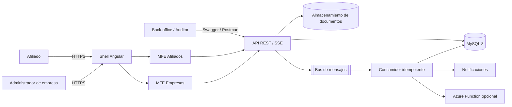
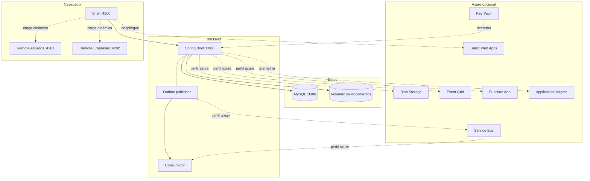
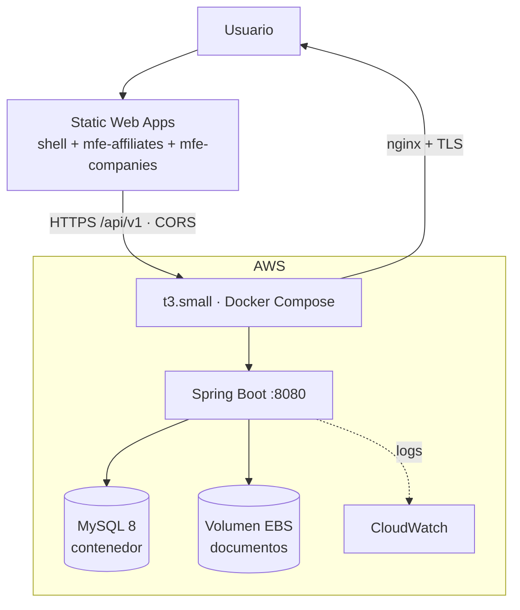
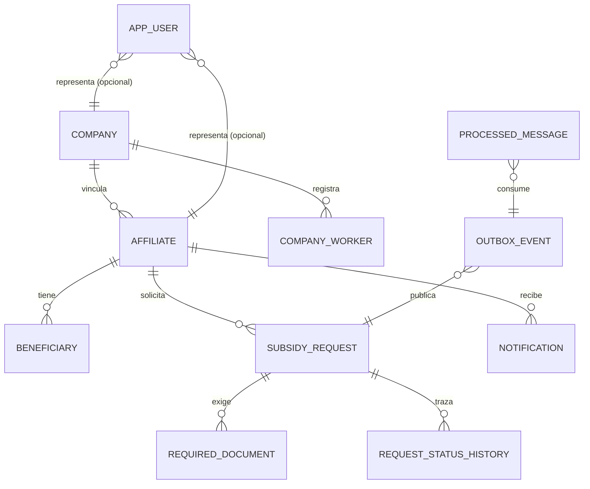
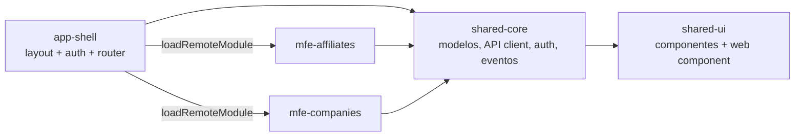

# 04 · Arquitectura baseline

Esta sección fija la arquitectura **antes** de continuar la implementación. Cualquier cambio posterior
debe reflejarse aquí y en un ADR.

## 4.1 Principios

1. **Monolito modular primero.** Un solo despliegue de backend con módulos por funcionalidad y
   fronteras explícitas; la extracción a servicios se decide con evidencia, no por moda.
2. **Puertos y adaptadores en los bordes.** Mensajería, almacenamiento y notificaciones dependen de
   interfaces; Azure y las implementaciones locales son intercambiables por configuración.
3. **El dominio no conoce HTTP ni JPA.** Entidades con comportamiento, servicios de aplicación
   transaccionales, controladores delgados.
4. **Reactividad con propósito.** Spring MVC para CRUD; Reactor para streaming (SSE), composición
   paralela y llamadas salientes. No se mezcla WebFlux y MVC en el mismo camino de ejecución.
5. **Seguridad por defecto.** Todo cerrado salvo lo explícitamente público; autorización por rol y por
   recurso; datos personales enmascarados desde el DTO.
6. **Consistencia antes que velocidad.** Outbox transaccional e idempotencia en el consumidor.
7. **Ejecutable sin nube.** Todo el flujo funciona en local; Azure es una opción de despliegue.

## 4.2 Contexto del sistema



## 4.3 Contenedores y despliegue



### 4.3.1 Despliegue vigente: frontend en Azure y backend en AWS EC2

El diagrama anterior describe los contenedores lógicos. El despliegue vigente mantiene el frontend en
Azure y mueve el backend y su plano de datos a una instancia EC2:



Lo que cambia no es el código: es **qué adaptadores se ejercitan**. En la topología vigente el backend corre con
`app.messaging.transport=local` y `app.storage.provider=local`, es decir, el mismo perfil que se usa en
local. Service Bus, Blob, Key Vault, Event Grid y la Function quedan fuera de la demostración, y con
ellos los requisitos `FR-AZR-01` a `FR-AZR-08` dejan de tener evidencia ejecutable. El detalle operativo
—tamaño, seguridad, TLS, coste y riesgos— está en el
[12 · Plan de despliegue](12-plan-despliegue-azure.md#1216-topologia-vigente-backend-en-aws-ec2).

## 4.4 Módulos del backend

| Módulo | Responsabilidad | Depende de |
|--------|-----------------|------------|
| `affiliate` | Perfil, beneficiarios, contacto | `company` (sólo lectura de nombre), `audit`, `security` |
| `company` | Perfil de empresa, trabajadores, reporte agregado | `audit`, `security` |
| `dashboard` | Agregación paralela del tablero del afiliado (Reactiva) | `affiliate`, `subsidy`, `notification` |
| `subsidy` | Agregado de solicitud, documentos, historial, reglas de demostración | `affiliate` (lectura), `messaging`, `storage`, `notification`, `audit` |
| `notification` | Persistencia y despacho de notificaciones | `security` |
| `messaging` | Outbox, envelope, publicadores, consumidor, idempotencia, fallidos | `subsidy` (handler), `notification`, `audit` |
| `storage` | Puerto de almacenamiento y adaptadores | — |
| `auth` | Identidad de demostración y emisión de JWT | `audit` |
| `audit` | Registro de operaciones | — |
| `security` | Configuración, principal actual, guardas de acceso | `auth` (claims) |
| `common` | Errores, paginación, correlación, enmascaramiento | — |
| `config` | Propiedades tipadas y configuración transversal | — |

**Regla de dependencia:** `api → application → domain`; `infrastructure/transport` implementa puertos
declarados en `application`. Un módulo no accede a los repositorios de otro: usa su servicio de
aplicación o una consulta explícita y documentada.

## 4.5 Decisiones de arquitectura (resumen)

| ID | Decisión | Alternativas descartadas | Razón |
|----|----------|--------------------------|-------|
| D1 | Monolito modular | Microservicios por dominio | Equipo y alcance de la prueba; los límites quedan preparados para extraer |
| D2 | Spring MVC + JPA como camino principal | WebFlux + R2DBC en todo el backend | MySQL/JPA es el requisito; Reactor se usa donde aporta (SSE, composición, salidas) |
| D3 | Outbox transaccional + broker abstracto | Publicar dentro del servicio o usar sólo eventos internos | Evita escritura dual y permite auditar/reenviar |
| D4 | JWT HS256 emitido localmente | Entra ID real | Autocontenido; el resource server es el mismo que se usaría con un IdP |
| D5 | Module Federation con webpack y Angular 18 | Native Federation, versiones mixtas | Compatibilidad declarada y reproducible; se documenta la matriz |
| D6 | Flyway con SQL portable | `ddl-auto=update` | Versionado, revisión y reproducibilidad; permite H2 y MySQL |
| D7 | Enmascaramiento en DTOs | Enmascarar en la vista o en el controlador | El dato sin enmascarar no puede salir por error de programación |
| D8 | SSE para tiempo real | WebSocket, polling | Unidireccional, simple, compatible con proxies y con `Flux` |
| D9 | Errores RFC 7807 | Estructura ad-hoc | Contrato estándar y estable para los portales |
| D10 | Adaptadores locales por configuración | Mocks en pruebas y código distinto en local | El camino de ejecución es el mismo que en Azure |

## 4.6 Contrato de API

| Aspecto | Convención |
|---------|------------|
| Base | `/api/v1` |
| Formato | JSON UTF-8; fechas ISO-8601 en UTC |
| Autenticación | `Authorization: Bearer <jwt>` |
| Correlación | `X-Correlation-Id` (aceptado y devuelto; se genera si falta) |
| Paginación | `page`, `size` (máx. 50), `sort=campo,asc\|desc`; respuesta con `content`, `page`, `size`, `totalElements`, `totalPages`, `first`, `last` |
| Filtros | Parámetros de consulta opcionales y combinables |
| Errores | `application/problem+json` con `type`, `title`, `status`, `detail`, `code`, `correlationId`, `errors[]` |
| Creación | `201 Created` + cabecera `Location` |
| Sin contenido | `204 No Content` |
| Conflictos | `409` para duplicados y concurrencia optimista |
| Regla de negocio | `422` con código estable |
| Idempotencia de escritura | `POST` de documentos es idempotente por tipo de documento; el reenvío del mismo mensaje no duplica efectos |

## 4.7 Modelo de datos



El detalle —13 tablas, columna por columna, enumeraciones, índices, estado y clasificación de datos
personales— está en el [11 · Diccionario de datos y modelo entidad-relación](11-diccionario-de-datos.md),
que es la fuente de verdad del esquema.

**Integridad:** las relaciones se modelan con identificadores y las claves foráneas se declaran en la
migración. La aplicación no usa `@ManyToOne`: valida la pertenencia antes de escribir y nunca borra en
cascada.

## 4.8 Frontend y microfrontends



| Elemento | Decisión |
|----------|----------|
| Shell | Autenticación, layout, navegación, carga de remotos, límites de error, versión mínima de contrato |
| Remotos | `mfe-affiliates` (:4201) y `mfe-companies` (:4202), expuestos como `./Routes` y `./Metadata` |
| Contratos | Modelos TypeScript en `shared-core`; eventos tipados con un bus (`PortalEventBus`); sin acceso directo a stores internos |
| Configuración de remotos | `assets/mf.manifest.json` leído en runtime, con valores por defecto de desarrollo |
| Fallo de carga | Componente de error con reintento y mensaje comprensible; el shell sigue operativo |
| Versiones | `Metadata` expone `contractVersion`; el shell rechaza versiones incompatibles |
| Estilos | SCSS con tokens, Flexbox/Grid, mobile first |
| Accesibilidad | Skip link, landmarks, foco visible, `aria-live` en estados, contraste AA |
| Web Component | `cs-status-badge` (Angular Element) reutilizado por ambos portales para justificar el caso de uso |

## 4.9 Correspondencia Azure ↔ local

| Capacidad | Producción (Azure) | Local (por defecto) | Activación |
|-----------|--------------------|---------------------|------------|
| Mensajería | Service Bus (cola `subsidy-requests`) | Publicador en proceso + pipeline Reactor | `app.messaging.transport=azure\|local` |
| Eventos de dominio externos | Event Grid (topic de documentos) | Logger estructurado | `app.integrations.event-grid.enabled` (prevista, no implementada) |
| Documentos | Blob Storage (contenedor privado) | Sistema de archivos local | `app.storage.provider=azure\|local` |
| Base de datos | Azure Database for MySQL Flexible Server | Contenedor `mysql:8.4` en `docker-compose` | `DB_URL`, `DB_USERNAME`, `DB_PASSWORD` |
| Notificaciones | Azure Function HTTP | Logger estructurado | `app.notifications.provider=azure-function\|local-log` |
| Secretos | Key Vault referenciado por App Service | Variables de entorno / `.env` | Pipeline y `application.yml` |
| Frontend | Static Web Apps | `ng serve` en tres puertos | Scripts npm |
| Observabilidad | Application Insights | Logs y Actuator | Configuración por perfil |

El inventario completo —rol, contrato, sustituto local, estado y requisitos `FR-AZR`— está en
[10 · Tecnologías de Azure](10-tecnologias-azure.md). Esta tabla solo resume la correspondencia.

## 4.10 Estructura del repositorio

```text
bits-americas-colsubsidio-fullstack-modernization/
├── README.md
├── docs/
│   ├── README.md
│   ├── 01-contexto-y-alcance.md
│   ├── 02-requisitos-funcionales.md
│   ├── 03-requisitos-no-funcionales.md
│   ├── 04-arquitectura-baseline.md
│   ├── 05-trazabilidad.md
│   ├── 06-plan-entrega.md
│   ├── 07-inventario-codigo-preliminar.md
│   ├── adr/                      # ADR-0001..0008 (fase 7)
│   ├── api/openapi.yaml          # contrato (fase 3)
│   ├── modernizacion/            # plan y matriz (fase 7)
│   └── demo/                     # guion y escenarios (fase 7)
├── backend/                      # Spring Boot
├── frontend/                     # workspace Angular (shell + 2 remotos + 2 libs)
├── azure/
│   ├── functions/                # Function App de ejemplo
│   └── bicep/                    # infraestructura como código
├── infra/
│   ├── docker/                   # Dockerfiles
│   ├── mysql/init/               # soporte de arranque local
│   └── docker-compose.yml
├── pipelines/                    # azure-pipelines.yml y plantillas
├── postman/                      # colección y entorno
└── legacy-lab/                   # módulo heredado mínimo (Java 8 / Boot 2.3)
```

## 4.11 Entornos y puertos

| Servicio | Puerto local | Notas |
|----------|--------------|-------|
| Backend | 8080 | `/swagger-ui.html`, `/actuator/health` |
| Shell | 4200 | Host de microfrontends |
| MFE afiliados | 4201 | `remoteEntry.js` |
| MFE empresas | 4202 | `remoteEntry.js` |
| MySQL | 3306 | Base `colsubsidio_demo` |
| Azure Functions | 7071 | Opcional, perfil azure |

## 4.12 Estrategia de pruebas

| Nivel | Herramienta | Alcance | Ejemplos |
|-------|-------------|---------|----------|
| Dominio | JUnit 5 | Transiciones, reglas, enmascaramiento | `SubsidyRequestTest`, `SubsidyDemoRulesTest` |
| Aplicación | JUnit + Mockito | Servicios con colaboradores simulados | `SubsidyRequestServiceTest`, `OutboxPublisherTest` |
| Integración | `@SpringBootTest` + MockMvc + H2 | Seguridad, validación, flujo completo, idempotencia | `SecurityIT`, `SubsidyRequestFlowIT`, `IdempotencyIT` |
| Frontend | Jest + Testing Library | Servicios, guardas, componentes de estado | `auth.service.spec.ts`, `requests.component.spec.ts` |
| Contrato | Revisión OpenAPI + colección Postman | Coherencia de endpoints y esquemas | `docs/api/openapi.yaml` |

## 4.13 Modernización (resumen; detalle en fase 7)

Ruta: inventario y línea base → pruebas de caracterización → actualización de dependencias con
OpenRewrite → `javax.*` a `jakarta.*` → Spring Security 5/6 a 6 (componentes explícitos, sin
`WebSecurityConfigurerAdapter`) → Hibernate 5 a 6 (dialectos, `@Type`, consultas) → configuración
(`spring.sql.init`, propiedades renombradas) → despliegue progresivo con rollback por versión.

Se incluirá un módulo heredado mínimo de laboratorio (`legacy-lab`) con código típico de Java 8 /
Boot 2.3 y su equivalente migrado, sin afirmar que se migró ningún sistema real.
