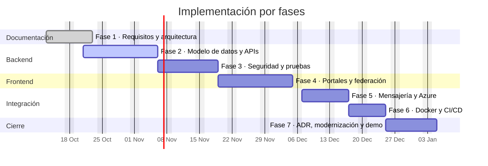

# 06 · Plan de entrega, riesgos y puertas de calidad

## 6.1 Estrategia

Entrega incremental con una **puerta de calidad al final de cada fase**. Ninguna fase se declara
cerrada sin evidencia ejecutada (compilación, pruebas o revisión), y ninguna prueba se reporta como
exitosa sin su salida real.

Prioridad de negocio: primero el flujo vertical completo (registrar → evento → consumidor →
documentos → consulta → decisión), después los portales y por último la infraestructura de despliegue.
La documentación de arquitectura y requisitos se cierra antes de escribir código nuevo (fase actual).

## 6.2 Fases

### Fase 1 · Alcance, requisitos y arquitectura — **completada (v1.0)**

| Actividad | Entregable |
|-----------|------------|
| Contexto, alcance, supuestos y reglas de demostración | `docs/01-contexto-y-alcance.md` |
| Requisitos funcionales con criterios de aceptación | `docs/02-requisitos-funcionales.md` |
| Requisitos no funcionales medibles | `docs/03-requisitos-no-funcionales.md` |
| Arquitectura baseline, contratos y modelo de datos | `docs/04-arquitectura-baseline.md` |
| Trazabilidad | `docs/05-trazabilidad.md` |
| Plan, riesgos y puertas | `docs/06-plan-entrega.md` |

**Criterio de salida:** requisitos sin ambigüedad bloqueante, decisiones arquitectónicas registradas y
matriz de trazabilidad completa.

### Fase 2 · Backend, datos y APIs

| Actividad | Entregable |
|-----------|------------|
| Alinear el esqueleto existente con la arquitectura | Paquetes y clases ajustados |
| Migraciones Flyway portables (esquema + datos sintéticos) | `backend/src/main/resources/db/migration` |
| Servicios y controladores de solicitudes, empresas, tablero y operación | `subsidy`, `company`, `dashboard`, `ops` |
| Seguridad completa (token, roles, ownership) | `auth`, `security` |
| Contrato OpenAPI | `docs/api/openapi.yaml` |

**Criterio de salida:** `mvn -q verify` compila; endpoints principales responden contra MySQL y H2;
el contrato OpenAPI coincide con los controladores.

### Fase 3 · Seguridad, pruebas y documentación de API

| Actividad | Entregable |
|-----------|------------|
| Pruebas unitarias de dominio, reglas y servicios | Suite JUnit + Mockito |
| Pruebas de integración de seguridad, flujo, idempotencia y documentos | Suite `@SpringBootTest` |
| Swagger UI verificado | Evidencia de ejecución |
| Revisión de enmascaramiento y auditoría | Checklist de privacidad |

**Criterio de salida:** todas las suites ejecutadas con salida adjunta; cobertura medida y reportada;
ningún endpoint crítico sin prueba.

### Fase 4 · Portales Angular y Module Federation

| Actividad | Entregable |
|-----------|------------|
| Workspace Angular 18 con shell, dos remotos y dos librerías | `frontend/` |
| Autenticación, layout, navegación y carga de remotos con manejo de errores | Shell |
| Vistas de afiliados: perfil, beneficiarios, solicitudes, documentos, notificaciones | `mfe-affiliates` |
| Vistas de empresas: perfil, trabajadores, bandeja y reporte | `mfe-companies` |
| Web Component de estado y tokens de diseño | `shared-ui` |
| Pruebas Jest | Suites por proyecto |

**Criterio de salida:** `npm run build` de los tres proyectos; `npm test` en verde con salida real;
navegación completa con el backend local; checklist WCAG aplicado.

### Fase 5 · Mensajería asíncrona y adaptadores Azure

| Actividad | Entregable |
|-----------|------------|
| Outbox, publicador, consumidor, idempotencia y fallidos | `messaging` |
| Adaptadores Service Bus, Blob y Function | `transport`, `storage`, `notification` |
| Function App de ejemplo y configuración de Event Grid | `azure/functions` |
| Infraestructura como código | `azure/bicep` |

**Criterio de salida:** flujo completo en local sin Azure; perfil `azure` validado por revisión de
configuración; ninguna ruta local depende de servicios cloud.

### Fase 6 · Docker, CI/CD y operación

| Actividad | Entregable |
|-----------|------------|
| Dockerfiles multi-stage y compose | `infra/` |
| Pipeline con etapas, pruebas, análisis y despliegue | `pipelines/` |
| Colección Postman y entornos | `postman/` |
| Guía de ejecución y troubleshooting | `README.md` |

**Criterio de salida:** `docker compose up` levanta el sistema (si el daemon está disponible);
pipeline válido sintácticamente con etapas documentadas; colección ejecutable contra local.

### Fase 7 · Modernización, ADR y presentación

| Actividad | Entregable |
|-----------|------------|
| ADR de las decisiones D1–D10 | `docs/adr/` |
| Plan de migración Java 8/Boot 2.3 → 17/3.x | `docs/modernizacion/plan.md` |
| Matriz de compatibilidad y recetas OpenRewrite | `docs/modernizacion/` |
| Módulo heredado de laboratorio y su equivalente migrado | `legacy-lab/` |
| Guion de demo y escenarios de prueba | `docs/demo/` |

**Criterio de salida:** un tercero puede ejecutar la migración guiándose por la documentación; el guion
de demo cubre todos los requisitos `M`.

## 6.3 Puertas de calidad (definition of done)

Un entregable se considera terminado cuando:

1. Compila o se ejecuta en el entorno documentado.
2. Tiene pruebas automatizadas o una verificación manual reproducible registrada.
3. No expone datos personales sin enmascarar ni secretos.
4. Está documentado (README, OpenAPI, ADR o guion, según corresponda).
5. Su salida real de ejecución está disponible para el evaluador.
6. No introduce advertencias críticas de seguridad ni dependencias vulnerables conocidas.

## 6.4 Riesgos

| # | Riesgo | Prob. | Impacto | Mitigación |
|---|--------|-------|---------|------------|
| R1 | Incompatibilidad entre Angular 18, plugin de federación y builder de webpack | Media | Alto | Versiones fijadas a la misma línea mayor; build temprano en Fase 4; alternativa documentada (Native Federation) si se cambia de versión |
| R2 | El daemon de Docker no está disponible en la máquina de evaluación | Alta | Medio | Pruebas con H2; ejecución local con MySQL instalado; compose documentado como opción |
| R3 | Diferencias H2/MySQL en SQL portable | Media | Medio | Evitar sintaxis específica; validar migraciones en ambos; perfil Testcontainers disponible |
| R4 | Crecimiento del alcance (back-office, pagos, IdP real) | Media | Alto | Alcance cerrado en el documento 01 y pregunta Q1–Q4 al evaluador |
| R5 | Pruebas inestables por asincronía | Media | Medio | Awaitility con timeouts acotados; modo síncrono configurable para pruebas deterministas |
| R6 | Fuga de datos personales en DTOs o logs | Baja | Alto | Enmascaramiento por construcción, revisión de DTOs, pruebas específicas |
| R7 | Tiempo insuficiente para las siete fases | Media | Alto | Priorización por valor: Fases 1–3 y 5 completas antes que acabados visuales |
| R8 | El resultado de una prueba se reporta sin ejecutarla | Baja | Alto | Regla explícita: sin salida real no se declara verde |

## 6.5 Convenciones de trabajo

- **Commits** en formato Conventional Commits (`feat:`, `fix:`, `test:`, `docs:`, `chore:`).
- **Ramas** cortas por fase o funcionalidad; `main` siempre ejecutable.
- **Configuración** por variables de entorno; sin credenciales en el repositorio.
- **Idioma**: documentación y mensajes de negocio en español; código, nombres técnicos y mensajes de
  error de API en inglés.
- **Decisiones**: toda decisión que afecte contratos, seguridad o despliegue se registra en un ADR.

## 6.6 Estimación de esfuerzo (referencia)

| Fase | Esfuerzo relativo | Comentario |
|------|-------------------|------------|
| 1 | Bajo | Documentación (completada) |
| 2 | Alto | Núcleo del backend y modelo de datos |
| 3 | Alto | Pruebas y seguridad |
| 4 | Alto | Tres proyectos Angular y federación |
| 5 | Medio | Mensajería y adaptadores |
| 6 | Medio | Contenedores y pipeline |
| 7 | Medio | Documentación técnica y guion |

## 6.7 Hoja de ruta visual

Las fechas son de referencia y suponen una dedicación de tiempo completo. La Fase 1 ya está cerrada;
las demás se encadenan con las dependencias de la sección 6.8.

## 6.8 Dependencias entre fases

| Fase | Depende de | Habilita | Riesgo si se adelanta |
|------|------------|----------|------------------------|
| 2 · Backend y datos | 1 | 3, 4, 5 | Contratos inestables que obligan a rehacer los portales |
| 3 · Seguridad y pruebas | 2 | 4, 6 | Portales contra endpoints sin esquema definitivo |
| 4 · Portales y federación | 2, 3 | 6 | Remotos que consumen DTOs que aún cambian |
| 5 · Mensajería y Azure | 2 | 6 | Consumidores sin esquema de eventos estable |
| 6 · Docker y CI/CD | 3, 4, 5 | 7 | Pipeline que empaqueta artefactos incompletos |
| 7 · ADR y modernización | 2 a 6 | — | Decisiones documentadas sobre código que aún cambia |

**Camino crítico:** 1 → 2 → 3 → 4 → 6 → 7. La Fase 5 puede ejecutarse en paralelo con la 4 porque solo
depende del esquema de eventos definido en la Fase 2.

**Regla de solapamiento:** una fase puede iniciarse cuando su predecesora haya superado su puerta de
calidad, aunque queden tareas de pulido. Lo que no se permite es congelar un contrato de API o de evento
sin las pruebas de la fase anterior en verde.
