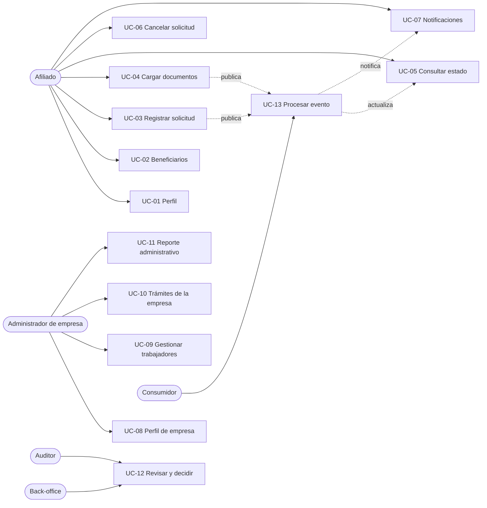

# 08 · Casos de uso

Catálogo formal de los casos de uso del prototipo. Cada caso declara actor, precondiciones, disparador,
flujo principal, flujos alternos, postcondiciones y los requisitos que implementa, de modo que pueda
usarse como guion de demostración y como base de las pruebas de aceptación.

## 8.1 Actores

| Actor | Rol técnico | Alcance |
|-------|-------------|---------|
| Afiliado | `ROLE_AFFILIATE` | Sus propios datos, solicitudes, documentos y notificaciones |
| Administrador de empresa | `ROLE_COMPANY` | Datos de su empresa, trabajadores y trámites asociados |
| Analista de back-office | `ROLE_BACKOFFICE` | Consulta transversal y decisión de demostración |
| Auditor | `ROLE_AUDITOR` | Consulta transversal de solo lectura |
| Consumidor de eventos | `system:subsidy-consumer` | Procesamiento asíncrono idempotente |

## 8.2 Mapa de actores y casos de uso

## 8.3 Convenciones

- **Flujo principal**: camino que termina en éxito.
- **Flujos alternos**: desviaciones esperadas (validación, permisos, estado, duplicados).
- **Postcondición**: estado observable al finalizar, incluso en el camino de error.
- Los identificadores `UC-xx` se referencian desde la [matriz de trazabilidad](05-trazabilidad.md#54-casos-de-uso).

---

## UC-01 · Consultar el perfil del afiliado

| Campo | Valor |
|-------|-------|
| Actor | Afiliado |
| Requisitos | FR-AFI-01, FR-AUT-05 |
| Endpoint | `GET /api/v1/affiliates/me` |
| Precondición | Token válido con `affiliateId` en los claims |
| Servicios Azure | Ninguno · solo Static Web Apps como hosting — free tier sí: 100 GB de banda al mes por suscripción |

**Flujo principal**

1. El portal obtiene el token del almacenamiento de sesión y lo adjunta como `Bearer`.
2. El backend valida firma, expiración y autoridad `ROLE_AFFILIATE`.
3. El servicio resuelve el afiliado a partir del claim, no de un parámetro de la ruta.
4. El mapper construye el DTO enmascarando documento, correo y teléfono.
5. El portal muestra nombre, categoría, estado, empresa y fechas.

**Flujos alternos**

- **A1 Token ausente o expirado** → 401 con `code=UNAUTHENTICATED`; el shell redirige al login conservando la ruta solicitada.
- **A2 Afiliado inexistente o inactivo** → 404 o 403 sin revelar si el registro existe.
- **A3 El afiliado intenta leer otro identificador** → 403 `ACCESS_DENIED` y registro en auditoría.

**Postcondición:** el afiliado ve únicamente su información, con datos personales enmascarados.

---

## UC-02 · Consultar beneficiarios

| Campo | Valor |
|-------|-------|
| Actor | Afiliado (o staff sobre un afiliado concreto) |
| Requisitos | FR-AFI-03 |
| Endpoint | `GET /api/v1/affiliates/me/beneficiaries` · `GET /api/v1/affiliates/{id}/beneficiaries` |
| Precondición | Sesión válida y pertenencia al afiliado (o rol de staff) |
| Servicios Azure | Ninguno |

**Flujo principal**

1. El portal solicita la lista de beneficiarios del afiliado autenticado.
2. La capa de aplicación valida la pertenencia con `AccessGuard`.
3. El repositorio devuelve los beneficiarios ordenados por nombre.
4. El mapper enmascara el documento de cada beneficiario.
5. El portal muestra parentesco, fecha de nacimiento y estado.

**Flujos alternos**

- **A1 Afiliado sin beneficiarios** → 200 con lista vacía y estado vacío explicativo en el portal.
- **A2 Acceso a un afiliado ajeno** → 403 y evento `PII_ACCESS` fallido en auditoría.

**Postcondición:** no se expone ningún documento completo ni dato de contacto de terceros.

---

## UC-03 · Registrar una solicitud de subsidio

| Campo | Valor |
|-------|-------|
| Actor | Afiliado |
| Requisitos | FR-SOL-01, FR-SOL-02, FR-SOL-03, FR-AUT-05 |
| Endpoint | `POST /api/v1/subsidy-requests` |
| Precondición | Afiliado `ACTIVE`, sin solicitud abierta del mismo tipo |
| Servicios Azure | Service Bus · `subsidy.request.submitted` — sin free tier: se paga por operaciones; cubierto por el crédito de 200 USD |

**Flujo principal**

1. El afiliado elige tipo, monto y motivo en el asistente del portal.
2. El portal valida formato y envía el `POST`.
3. El backend autoriza por rol y resuelve el afiliado desde el token.
4. `SubsidyDemoRules` valida monto positivo, límite por tipo y elegibilidad de categoría.
5. El servicio verifica que no exista otra solicitud abierta del mismo tipo.
6. Se persisten, en una sola transacción, la solicitud `SUBMITTED`, los documentos requeridos, la primera entrada de historial y el evento de outbox.
7. La respuesta es 201 con `Location` y el número de radicado.
8. El publicador del outbox entrega el evento al consumidor.

**Flujos alternos**

- **A1 Monto sobre el límite** → 422 `AMOUNT_ABOVE_DEMO_LIMIT`, sin persistencia.
- **A2 Solicitud abierta del mismo tipo** → 409 `DUPLICATE_OPEN_REQUEST`.
- **A3 Educación sin beneficiarios** → 422 `NO_BENEFICIARIES`.
- **A4 Crédito en categoría C** → 422 `CATEGORY_NOT_ELIGIBLE`.
- **A5 Falla al escribir el outbox** → rollback completo; no queda solicitud sin evento.

**Postcondición:** la solicitud existe en `SUBMITTED`, con documentos `PENDING` y evento en outbox.

---

## UC-04 · Cargar un documento requerido

| Campo | Valor |
|-------|-------|
| Actor | Afiliado |
| Requisitos | FR-SOL-05, FR-SOL-06, FR-SOL-07 |
| Endpoint | `POST /api/v1/subsidy-requests/{id}/documents` |
| Precondición | Solicitud propia en estado abierto y documento del catálogo |
| Servicios Azure | Blob Storage · evidencia — sin free tier: pago por GB y operaciones. Event Grid previsto — free tier sí: 100 000 operaciones al mes |

**Flujo principal**

1. El portal envía el archivo como `multipart/form-data` con el tipo de documento.
2. El backend valida pertenencia, estado de la solicitud y tipo de documento.
3. El almacenamiento valida MIME y tamaño, calcula SHA-256 y guarda con clave opaca.
4. El documento pasa a `RECEIVED` con nombre, tipo, tamaño y checksum.
5. Se publica `subsidy.document.uploaded` en el outbox.
6. El consumidor recalcula la completitud y, si ya no faltan evidencias, mueve la solicitud a `IN_REVIEW`.

**Flujos alternos**

- **A1 Tipo no permitido** → 422 `FILE_TYPE_NOT_ALLOWED`; no se escribe archivo.
- **A2 Archivo mayor a 5 MB** → 413 `FILE_TOO_LARGE`; el contenedor descarta el cuerpo.
- **A3 Documento ya cargado** → reemplazo controlado, conservando el checksum anterior en auditoría.
- **A4 Solicitud en estado terminal** → 422 `INVALID_STATUS_TRANSITION`.

**Postcondición:** el documento queda disponible para el afiliado y para el back-office, con trazabilidad.

---

## UC-05 · Consultar el estado y el historial en tiempo real

| Campo | Valor |
|-------|-------|
| Actor | Afiliado, empresa o back-office |
| Requisitos | FR-AFI-05, FR-AFI-06, FR-SOL-08, FR-SOL-12 |
| Endpoint | `GET /api/v1/subsidy-requests/{id}` · `GET .../history` · `GET .../events` (SSE) |
| Precondición | Acceso autorizado al recurso |
| Servicios Azure | Ninguno · SSE en proceso |

**Flujo principal**

1. El portal solicita el detalle de la solicitud.
2. El backend autoriza por rol y por recurso.
3. Devuelve estado, monto, fechas, documentos con su estado e historial ordenado.
4. El portal abre un `EventSource` contra `/events`.
5. Cada transición se publica en el `Sinks.Many` y llega como `ServerSentEvent`.
6. El portal actualiza la línea de tiempo sin recargar y anuncia el cambio con `aria-live`.

**Flujos alternos**

- **A1 Sin permisos sobre la solicitud** → 403; el portal muestra un mensaje sin detalles del recurso.
- **A2 Corte de la conexión SSE** → reconexión automática del navegador con `Last-Event-ID` y `heartbeat`.
- **A3 Sin cambios durante el tiempo de espera** → latido periódico para evitar el cierre por proxies.

**Postcondición:** el usuario ve el estado vigente y el historial completo, con actor, motivo y fecha.

---

## UC-06 · Cancelar una solicitud

| Campo | Valor |
|-------|-------|
| Actor | Afiliado |
| Requisitos | FR-SOL-09, FR-SOL-11 |
| Endpoint | `POST /api/v1/subsidy-requests/{id}/cancel` |
| Precondición | Solicitud propia en `SUBMITTED`, `PENDING_DOCUMENTS` o `IN_REVIEW` |
| Servicios Azure | Ninguno |

**Flujo principal**

1. El portal solicita confirmación explicando que la acción es irreversible.
2. El backend valida pertenencia y estado.
3. El agregado aplica la transición a `CANCELLED` y registra el motivo.
4. Se añade la entrada de historial y la notificación al afiliado.

**Flujos alternos**

- **A1 Estado terminal** → 422 `INVALID_STATUS_TRANSITION`.
- **A2 Solicitud ajena** → 403.

**Postcondición:** la solicitud queda en `CANCELLED` y no admite nuevas cargas.

---

## UC-07 · Consultar y marcar notificaciones

| Campo | Valor |
|-------|-------|
| Actor | Afiliado |
| Requisitos | FR-AFI-07, FR-ASY-05 |
| Endpoint | `GET /api/v1/affiliates/me/notifications` · `PATCH .../{id}/read` |
| Precondición | Sesión válida |
| Servicios Azure | Ninguno |

**Flujo principal**

1. El portal consulta la bandeja paginada y el contador de no leídas.
2. El backend devuelve las notificaciones del afiliado autenticado.
3. Al abrir una notificación, el portal la marca como leída.
4. El backend actualiza de forma idempotente y devuelve 204.

**Flujos alternos**

- **A1 Notificación de otro afiliado** → 404, sin distinguir de una inexistente.
- **A2 Marcado repetido** → 204 sin error.

**Postcondición:** el contador refleja el estado real y no se altera la de otros usuarios.

---

## UC-08 · Consultar el perfil de la empresa

| Campo | Valor |
|-------|-------|
| Actor | Administrador de empresa |
| Requisitos | FR-EMP-01, FR-EMP-07 |
| Endpoint | `GET /api/v1/companies/me` |
| Precondición | Token con `companyId` |
| Servicios Azure | Ninguno |

**Flujo principal**

1. El portal solicita el perfil sin enviar identificador.
2. El backend resuelve la empresa desde el claim.
3. Devuelve razón social, NIT con dígito de verificación enmascarado, sector, tamaño, ciudad y número de afiliados.

**Flujos alternos**

- **A1 Token sin `companyId`** → 403.
- **A2 Empresa inactiva** → 200 con estado `INACTIVE` y aviso en el portal.

**Postcondición:** la empresa ve solo su información.

---

## UC-09 · Gestionar trabajadores de demostración

| Campo | Valor |
|-------|-------|
| Actor | Administrador de empresa |
| Requisitos | FR-EMP-02, FR-EMP-03, FR-EMP-04 |
| Endpoint | `GET/POST /api/v1/companies/me/workers` · `PATCH .../{id}` |
| Precondición | Empresa activa |
| Servicios Azure | Ninguno |

**Flujo principal**

1. El portal lista trabajadores con filtro por estado y búsqueda, paginados.
2. El administrador registra un trabajador con documento, nombre, cargo y fecha de ingreso.
3. El backend valida campos y unicidad del documento dentro de la empresa.
4. Se persiste el trabajador y se registra auditoría.
5. El administrador puede cambiar el estado a `ACTIVE` o `INACTIVE`.

**Flujos alternos**

- **A1 Documento duplicado en la empresa** → 409 `DATA_CONFLICT`.
- **A2 Trabajador de otra empresa** → 404.
- **A3 Datos inválidos** → 400 con errores por campo.

**Postcondición:** el registro queda disponible solo para la empresa propietaria.

---

## UC-10 · Consultar los trámites de la empresa con datos minimizados

| Campo | Valor |
|-------|-------|
| Actor | Administrador de empresa |
| Requisitos | FR-EMP-05, NFR-PRI-02 |
| Endpoint | `GET /api/v1/companies/me/subsidy-requests` |
| Precondición | Empresa con afiliados |
| Servicios Azure | Ninguno |

**Flujo principal**

1. El portal solicita los trámites con filtros de estado y tipo.
2. El backend restringe la consulta al `companyId` del token mediante especificación.
3. Devuelve número, tipo, estado, monto, fecha y documento del afiliado enmascarado.
4. El portal muestra la bandeja sin nombres ni datos de contacto.

**Flujos alternos**

- **A1 Intento de filtrar por otra empresa** → el parámetro se ignora y se aplica el del token.
- **A2 Sin trámites** → 200 con página vacía.

**Postcondición:** la empresa no recibe datos personales innecesarios.

---

## UC-11 · Consultar el reporte administrativo

| Campo | Valor |
|-------|-------|
| Actor | Administrador de empresa, auditor |
| Requisitos | FR-EMP-06 |
| Endpoint | `GET /api/v1/companies/me/reports/summary` |
| Precondición | Sesión válida con empresa asociada |
| Servicios Azure | Ninguno |

**Flujo principal**

1. El portal solicita el resumen del periodo.
2. El backend agrega conteos por estado y tipo, trabajadores activos y monto solicitado.
3. Devuelve la serie agregada sin identificadores personales.
4. El portal representa los totales en tarjetas y una tabla.

**Flujos alternos**

- **A1 Periodo inválido** → 400 `VALIDATION_ERROR`.
- **A2 Periodo sin datos** → 200 con ceros explícitos.

**Postcondición:** el reporte es agregado y no permite reidentificar a un afiliado.

---

## UC-12 · Revisar y registrar una decisión de demostración

| Campo | Valor |
|-------|-------|
| Actor | Analista de back-office |
| Requisitos | FR-SOL-10, FR-SOL-11, FR-AUT-04 |
| Endpoint | `POST /api/v1/subsidy-requests/{id}/review` |
| Precondición | Solicitud en `IN_REVIEW` y documentos completos |
| Servicios Azure | Service Bus · evento de decisión (previsto) — sin free tier: se paga por operaciones |

**Flujo principal**

1. El analista consulta la solicitud, sus documentos y el historial.
2. Verifica la evidencia y elige aprobar o rechazar en modo demostración.
3. Escribe un motivo obligatorio de 10 a 400 caracteres.
4. El backend valida la autoridad `ROLE_BACKOFFICE` y la transición.
5. La solicitud pasa a `APPROVED_DEMO` o `REJECTED_DEMO`, con fecha y motivo.
6. Se registra historial, auditoría y notificación al afiliado.

**Flujos alternos**

- **A1 Rol distinto de back-office** → 403 antes de ejecutar el cuerpo.
- **A2 Motivo ausente o demasiado corto** → 400 `VALIDATION_ERROR`.
- **A3 Estado no revisable** → 422 `INVALID_STATUS_TRANSITION`.
- **A4 Dos analistas deciden a la vez** → 409 por bloqueo optimista; solo una decisión prevalece.

**Postcondición:** la decisión queda marcada como demostración y es trazable, sin efecto oficial.

---

## UC-13 · Procesar un evento de solicitud o de documento

| Campo | Valor |
|-------|-------|
| Actor | Consumidor de eventos |
| Requisitos | FR-ASY-01, FR-ASY-02, FR-ASY-03, FR-ASY-04 |
| Endpoint | Interno: outbox → transporte local o Service Bus |
| Precondición | Envelope válido con `messageId` único |
| Servicios Azure | Service Bus · consumo — sin free tier. Function de notificación (prevista) — free tier sí: 1 000 000 de ejecuciones y 400 000 GB-s al mes |

**Flujo principal**

1. El publicador lee el outbox pendiente y envía el envelope.
2. El consumidor verifica si `(messageId, consumer)` ya fue procesado.
3. Ejecuta el manejador dentro de una transacción.
4. Clasifica la solicitud en `PENDING_DOCUMENTS` o `IN_REVIEW`.
5. Registra historial, notificación y auditoría.
6. Marca el mensaje como procesado y el outbox como publicado.

**Flujos alternos**

- **A1 Mensaje duplicado** → se descarta sin segundo efecto; queda evidencia en `processed_message`.
- **A2 Fallo transitorio** → reintentos con backoff exponencial.
- **A3 Reintentos agotados** → fila en `failed_message` con el error y el payload.
- **A4 Evento desconocido** → se registra y se ignora, sin romper el consumidor.

**Postcondición:** el estado es consistente con el evento y existe trazabilidad completa.

## 8.4 Servicios Azure por caso de uso

| Caso | Servicio de Azure | Para qué |
|------|-------------------|----------|
| UC-01 | Solo Static Web Apps (hosting) | Servir el portal que consume la API |
| UC-02 | Ninguno | Lectura directa de MySQL |
| UC-03 | Service Bus | Publicar `subsidy.request.submitted` para clasificar la solicitud |
| UC-04 | Blob Storage · Event Grid (previsto) | Guardar la evidencia y avisar a suscriptores |
| UC-05 | Ninguno | El estado se empuja por SSE desde el mismo proceso |
| UC-06 | Ninguno | Cambio de estado síncrono con historial y notificación |
| UC-07 | Ninguno | Bandeja de notificaciones en MySQL |
| UC-08 | Ninguno | Lectura de la empresa |
| UC-09 | Ninguno | CRUD de trabajadores sintéticos |
| UC-10 | Ninguno | Consulta agregada con datos minimizados |
| UC-11 | Ninguno | Agregaciones sobre MySQL |
| UC-12 | Service Bus (previsto) | Propagar el cambio de estado a otros consumidores |
| UC-13 | Service Bus · Function (prevista) | Consumir el evento y disparar la notificación |

**Ocho de los trece casos no requieren ningún servicio de integración de Azure.** Solo los tres que
cruzan una frontera asíncrona (UC-03, UC-12, UC-13) y el que manipula binarios (UC-04) lo necesitan.
Añadir mensajería a una lectura de perfil sería sobrearquitectura, y el diseño lo evita a propósito.

**Ninguno significa ningún servicio de integración.** La persistencia en MySQL y el hosting en Static
Web Apps son transversales: los trece casos leen o escriben en el motor relacional, así que en Azure
todos pasan por el servidor flexible de MySQL, igual que todos se sirven desde el mismo hosting.

## 8.5 Free tier de los servicios usados

Consulta del **2026-10-20** sobre las páginas públicas de precios y la lista de servicios gratuitos de
Azure. Las cuotas cambian con el tiempo: hay que reconfirmarlas antes de desplegar.

| Servicio | ¿Entra en free tier? | Capacidad incluida | Al superarla |
|----------|----------------------|--------------------|--------------|
| Azure Functions (Consumption) | Sí, permanente | 1 000 000 de ejecuciones y 400 000 GB-s al mes por suscripción | 0,20 USD por millón de ejecuciones y 0,000016 USD por GB-s |
| Azure Functions (Flex Consumption) | Sí, permanente | 250 000 ejecuciones y 100 000 GB-s al mes | Se factura por ejecución y por GB-s |
| Service Bus | **No** | Sin cuota gratuita; Basic se factura por operaciones y Standard por hora base | Crédito de 200 USD o pago por uso |
| Event Grid | Sí, permanente | 100 000 operaciones al mes | 0,60 USD por millón de operaciones |
| Blob Storage | **No** | No figura en la lista de servicios gratuitos; se paga por GB almacenado y por operaciones | Pago por uso |
| Static Web Apps (plan Free) | Sí, permanente | 100 GB de banda al mes por suscripción, 0,5 GB de almacenamiento por app y 2 dominios | El sitio deja de servirse hasta el siguiente ciclo; sin SLA |
| Azure Database for MySQL Flexible | Solo 12 meses, cuentas nuevas | 750 h de Burstable B1MS, 32 GB de datos y 32 GB de backup | Pago por uso |
| Key Vault | **No** | Se factura por operaciones | Pago por uso |
| Application Insights | Sí, parcial | 5 GB al mes por cuenta de facturación | 2,30 USD por GB |

**Conclusión:** el flujo de la prueba cabe en free tier salvo **Service Bus**, **Blob Storage**,
**Key Vault** y MySQL tras los primeros 12 meses. Para una demo de 2,5 meses el crédito de 200 USD de
la cuenta gratuita cubre esos tres servicios con holgura, y el consumo esperado se mide en centavos por
operaciones.

**Aviso sobre el alojamiento del backend:** App Service no está en la lista anterior porque no participa
en ningún caso de uso, pero publicar la API sí cuesta. Su cuota gratuita permanente (hasta 10 apps con
1 GB y 1 hora al día) no alcanza para un servicio disponible 24/7, así que un despliegue real requiere
plan de pago o Container Apps.

El detalle de qué servicio gratuito se podría añadir a cada caso, y cuáles no admiten sustituto
gratuito, está en la sección 8.6.

## 8.6 Free tier aplicable caso por caso

La sección 8.5 dice cuánto cuesta cada servicio que ya participa. Esta sección responde la pregunta
contraria: qué servicio **gratuito** se podría sumar a cada caso, y qué casos dependen hoy de algo que no
es gratuito.

| Caso | Free tier ya aplicado | Free tier que se podría añadir | Límite a vigilar |
|------|-----------------------|-------------------------------|------------------|
| UC-01 · Perfil del afiliado | Static Web Apps (hosting del portal) | Application Insights para trazar el endpoint | 100 GB de banda y 5 GB de ingesta al mes |
| UC-02 · Beneficiarios | Ninguno: no toca Azure | Application Insights | 5 GB de ingesta al mes |
| UC-03 · Registrar solicitud | Ninguno: Service Bus no es gratuito | Event Grid como bus de eventos de la demo | 100 000 operaciones al mes |
| UC-04 · Cargar documento | Event Grid (previsto) | Functions Consumption para validar tipo y tamaño y calcular el SHA-256 | 1 000 000 de ejecuciones al mes |
| UC-05 · Estado en tiempo real | Ninguno: SSE en el mismo proceso | Application Insights para medir la duración del stream | 5 GB de ingesta al mes |
| UC-06 · Cancelar solicitud | Ninguno | Event Grid para avisar la cancelación | 100 000 operaciones al mes |
| UC-07 · Notificaciones | Functions Consumption (prevista) | Event Grid para entregar el aviso | 1 000 000 de ejecuciones y 100 000 operaciones |
| UC-08 · Perfil de empresa | Static Web Apps (hosting) | Application Insights | 100 GB de banda y 5 GB de ingesta |
| UC-09 · Trabajadores | Static Web Apps (hosting) | — | 100 GB de banda al mes |
| UC-10 · Trámites minimizados | Static Web Apps (hosting) | Application Insights | 100 GB de banda y 5 GB de ingesta |
| UC-11 · Reporte administrativo | Ninguno | Function con temporizador que precalcule el reporte | 1 000 000 de ejecuciones (30 al mes con frecuencia diaria) |
| UC-12 · Decisión de demostración | Ninguno: Service Bus no es gratuito | Event Grid para el evento de decisión | 100 000 operaciones al mes |
| UC-13 · Procesar evento | Functions Consumption (prevista) | Event Grid como disparador en lugar de Service Bus | 1 000 000 de ejecuciones y 100 000 operaciones |

**Diez de los trece casos no tocan ningún servicio de Azure de pago.** Solo UC-03 y UC-13 dependen de
Service Bus y UC-04 de Blob Storage. Si en una demo se sustituyen esos dos servicios —Event Grid en
lugar de la cola y el adaptador de disco local en lugar del contenedor— el prototipo completo corre
dentro del año gratuito.

**Azure Database for MySQL aplica a los trece casos.** Toda lectura y escritura pasa por el motor
relacional: en local es un contenedor y en Azure, un servidor flexible. Es la diferencia entre «ningún
servicio de integración» y «ningún servicio de Azure»: la base entra en el año gratuito, pero no es una
cuota permanente, y desde el mes 13 es coste fijo aunque el caso no cambie.

**Application Insights aplica a los trece casos.** Es telemetría transversal, no una dependencia
funcional: si se cae, el caso de uso sigue funcionando. Por eso no se repite como servicio principal en
la tabla de la sección 8.4.

**Event Grid no sustituye a Service Bus.** Sirve para repartir eventos de dominio con reintento, pero no
ofrece consumidores competidores, sesiones ni transacciones, y su cola de mensajes fallidos exige un
contenedor de Blob (de pago). Se puede usar para el fan-out de la demo; no para una cola de trabajo real.

**Lo que no entra en free tier:** Service Bus, Blob Storage y Key Vault no tienen cuota gratuita, y
MySQL Flexible solo es gratuito 12 meses en cuentas nuevas. Para una demo de 2,5 meses los cubre el
crédito de 200 USD; para producción son coste fijo.

**Estado:** la columna «se podría añadir» es diseño previsto, no implementación. Hoy lo único
desplegable es el hosting en Static Web Apps; Functions y Event Grid están en el plan y marcados como
previstos en la [sección 10](10-tecnologias-azure.md).

## 8.7 Cobertura

| Grupo | Casos | Requisitos `M` cubiertos |
|-------|-------|--------------------------|
| Afiliado | UC-01 a UC-07 | FR-AFI-01, FR-AFI-03, FR-AFI-04, FR-AFI-05, FR-SOL-01, FR-SOL-05, FR-SOL-08 |
| Empresa | UC-08 a UC-11 | FR-EMP-01, FR-EMP-02, FR-EMP-03, FR-EMP-05, FR-EMP-07 |
| Back-office | UC-12 | FR-SOL-10, FR-SOL-11 |
| Sistema | UC-13 | FR-ASY-01 a FR-ASY-04 |

Los casos `S` (FR-AFI-02, FR-AFI-07, FR-AFI-08, FR-EMP-04, FR-EMP-06, FR-SOL-07, FR-SOL-09, FR-SOL-12) se cubren en UC-04, UC-05, UC-06, UC-07, UC-09 y UC-11.
