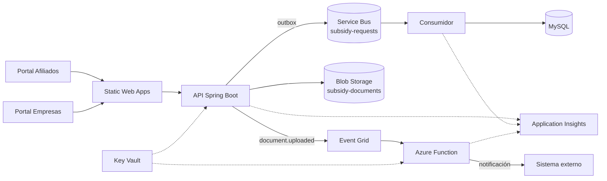

# 10 · Tecnologías de Azure en la prueba técnica

Inventario único de los servicios de Azure que intervienen en el prototipo: para qué se usan, qué
contrato exponen, con qué se sustituyen en local y en qué estado están. Si un servicio no aparece aquí,
no forma parte del alcance.

> Nada de esto se ejecutó contra una suscripción real. La prueba corre en local con adaptadores; los
> servicios de Azure son el destino previsto y su configuración está versionada como ejemplo.

## 10.1 Para qué se usa Azure

| Necesidad | Servicio | Por qué no se resuelve en el backend |
|-----------|----------|--------------------------------------|
| Procesar tareas lentas fuera de la petición HTTP | Service Bus + consumidor | El afiliado no debe esperar la clasificación documental |
| Notificar a sistemas externos un documento cargado | Event Grid + Function | Desacopla el upload de los suscriptores |
| Guardar evidencias fuera de la base | Blob Storage | Los binarios no pertenecen a MySQL |
| Persistir el estado transaccional | Azure Database for MySQL | Es el motor relacional del dominio; en local corre como contenedor y en Azure como servidor flexible |
| Validar y notificar sin mantener servidores | Azure Functions | Carga esporádica, costo por ejecución |
| Publicar los portales | Static Web Apps | CDN y ruteo sin servidor |
| Custodiar secretos | Key Vault | El repositorio no puede contener cadenas de conexión |
| Observar el flujo completo | Application Insights | Correlacionar API, Function y consumidor |

## 10.2 Mapa de servicios



## 10.3 Matriz de intervención

| Servicio | Rol en la prueba | Disparador / binding | Contrato | Sustituto local | Propiedad de conmutación | Estado | Free tier |
|---|---|---|---|---|---|---|---|
| **Service Bus** | Cola de trabajo `subsidy-requests` para clasificar solicitudes y recalcular documentos | Outbox → `ServiceBusSenderClient`; consumidor `ServiceBusProcessorClient` | `DomainEventEnvelope` en JSON, `messageId` = id del outbox | Publicador en proceso + pipeline Reactor | `app.messaging.transport=local\|azure` | Parcial: adaptadores escritos, sin broker real | No: sin cuota gratuita |
| **Azure Functions** | Validación de documentos y envío de notificaciones | HTTP trigger (backend) y Service Bus trigger (previsto) | JSON con `notificationId`, `requestId`, `correlationId` | `LocalLoggingNotificationGateway` | `app.notifications.provider=local-log\|azure-function` | Parcial: solo el cliente HTTP; la Function no existe | Sí, permanente: 1 M de ejecuciones y 400 000 GB-s al mes |
| **Event Grid** | Aviso `document.uploaded` a suscriptores | Topic custom, CloudEvent 1.0 | `type`, `subject`, `data.documentId`, `data.requestId` | Logger estructurado | `app.integrations.event-grid.enabled` (prevista) | Pendiente | Sí, permanente: 100 000 operaciones al mes |
| **Blob Storage** | Evidencias de la solicitud en contenedor privado | SDK `BlobContainerClient` | Clave opaca `{requestId}/{uuid}.{ext}`, checksum SHA-256, content-type validado | `LocalFileSystemDocumentStorage` en `target/document-storage` | `app.storage.provider=local\|azure` | Parcial: adaptador escrito, sin cuenta real | No: sin cuota gratuita |
| **Table Storage** | No se usa | — | — | — | — | **Fuera de alcance** (ver 10.9) | No aplica: fuera de alcance |
| **Static Web Apps** | Publicación de shell y remotos | Deploy de `dist/` por pipeline | `staticwebapp.config.json` con fallback de rutas | `ng serve` en 4200 / 4201 / 4202 | Scripts npm | Pendiente | Sí, plan Free: 100 GB de banda al mes |
| **Key Vault** | Secretos de conexión y clave JWT | Referencia desde App Service y Function | Nombres de secreto por entorno | Variables de entorno / `.env` no versionado | `AZURE_KEY_VAULT_URI` (prevista) | Pendiente | No: se factura por operaciones |
| **Azure Database for MySQL Flexible Server** | Persistencia transaccional del dominio y del historial; Flyway versiona el esquema | JDBC con Hikari (`mysql-connector-j`) y migraciones con `flyway-mysql` | Esquema versionado en `db/migration`; TLS obligatorio (`sslMode=REQUIRED`) fuera de local | Contenedor `mysql:8.4` en `docker-compose` | `DB_URL`, `DB_USERNAME`, `DB_PASSWORD` | Pendiente: solo contenedor local, sin servidor real | Sí, pero solo 12 meses: 750 h B1MS y 32 GB en cuentas nuevas |
| **Application Insights** | Trazas correlacionadas de API, consumidor y Function | Agente/SDK | `operation_Id` = `correlationId` | Logs con MDC `correlationId` | `APPLICATIONINSIGHTS_CONNECTION_STRING` | Pendiente | Sí, parcial: 5 GB de ingesta al mes |

## 10.4 Requisitos de integración

| ID | Requisito | Prioridad | Criterio de aceptación |
|----|-----------|-----------|------------------------|
| FR-AZR-01 | Todo mensaje publicado lleva `messageId` estable igual al id del registro de outbox | M | Reenviar el mismo outbox produce el mismo `messageId` y el consumidor lo descarta por idempotencia |
| FR-AZR-02 | Entrega al menos una vez con un máximo de 3 intentos y retroceso exponencial | M | Un fallo transitorio se reintenta; al agotar intentos el mensaje queda en `failed_message` y se completa en el broker para evitar bucles |
| FR-AZR-03 | La carga de un documento publica un CloudEvent en Event Grid | S | El evento contiene `documentId`, `requestId` y `correlationId`; sin suscriptor el upload no falla |
| FR-AZR-04 | El contenedor de evidencias es privado y la descarga solo ocurre vía API con control de propiedad | M | Un afiliado no puede leer el documento de otro; la URL del blob no se expone al cliente |
| FR-AZR-05 | La Function de notificaciones es idempotente por `notificationId` | S | Invocarla dos veces con el mismo id no genera dos envíos |
| FR-AZR-06 | El adaptador local y el de Azure respetan el mismo contrato | M | La misma prueba de integración pasa con `local` y con un doble del SDK; el handler no cambia |
| FR-AZR-07 | Sin secretos en el repositorio y fallo rápido si falta configuración | M | Arrancar con `transport=azure` sin cadena de conexión falla al iniciar con mensaje claro |
| FR-AZR-08 | Los portales se sirven con fallback de rutas para enlaces profundos | S | Recargar `/affiliates/requests/42` devuelve el shell y no un 404 |
| FR-AZR-09 | Toda operación de un caso de uso emite un evento `audit.*` a Event Grid, escrito en el outbox dentro de la transacción del agregado | M | Con el publicador caído el caso responde igual y el evento queda `PENDING`; la auditoría se recupera al volver el servicio |

## 10.5 Contrato del mensaje

El envelope es único para los dos transportes:

```json
{
  "messageId": "9f1c2d3e-4b5a-4c6d-8e7f-0a1b2c3d4e5f",
  "eventType": "subsidy.request.submitted",
  "aggregateType": "SubsidyRequest",
  "aggregateId": "42",
  "occurredAt": "2026-10-20T16:42:07Z",
  "correlationId": "b1e2f3a4-5c6d-7e8f-9a0b-1c2d3e4f5a6b",
  "payload": "{\"requestId\":42,\"affiliateId\":7,\"subsidyType\":\"VIVIENDA\"}"
}
```

Limitación conocida: `payload` viaja como **cadena JSON** dentro del envelope, lo que produce doble
codificación y complica la lectura en herramientas del broker. La corrección prevista es declararlo
como objeto (`JsonNode`) manteniendo compatibilidad con los mensajes ya publicados.

## 10.6 Contrato del documento

| Atributo | Regla |
|----------|-------|
| Clave | `{requestId}/{uuid}.{ext}`; el cliente nunca la elige |
| Tipo permitido | `application/pdf`, `image/png`, `image/jpeg` |
| Tamaño máximo | 5 MB (configurable) |
| Integridad | SHA-256 calculado en streaming y almacenado en MySQL |
| Acceso | Contenedor privado; descarga mediante endpoint con `AccessGuard` |
| Nombre original | Se conserva solo como metadato, saneado |

## 10.7 Fallos, reintentos y cola de fallidos

1. El consumidor comprueba idempotencia por `(messageId, consumer)` antes de ejecutar.
2. Si el handler falla, Reactor reintenta con `Retry.backoff` hasta `max-attempts`.
3. Agotados los intentos, se guarda el mensaje en `failed_message` con la causa y se completa el mensaje en el broker: se prefiere un registro consultable a un bucle de reentrega.
4. El back-office puede reintentar desde `GET /api/v1/ops/failed-messages` cuando la causa esté corregida.

## 10.8 Paridad local ↔ Azure

| Aspecto | Local | Azure | Cómo se demuestra |
|---------|-------|--------|-------------------|
| Mensajería | Publicador en proceso | Service Bus | Misma clase `SubsidyMessageHandler`; prueba con doble del sender |
| Documentos | Sistema de archivos | Blob | Misma interfaz `DocumentStorage`; contrato de checksum y content-type |
| Notificaciones | Log estructurado | Function HTTP | Mismo `NotificationGateway`; prueba con `MockWebServer` |
| Eventos | Log | Event Grid | Pendiente de implementar el adaptador |
| Secretos | Variables de entorno | Key Vault | Misma resolución de propiedades |

## 10.9 Servicios evaluados y descartados

| Servicio | Decisión | Motivo |
|----------|----------|--------|
| Table Storage | Descartado | El caso usa MySQL como relacional y Blob para binarios; añadir Table sería duplicar persistencia sin necesidad |
| Container Apps | Descartado | App Service con contenedor cubre el requisito con menos piezas; el JD pide Docker y pipelines, no orquestación |
| Azure Container Registry | Previsto, no confirmado | Solo es necesario si el pipeline publica imágenes; se decide en Fase 6 |
| Logic Apps | Descartado | La orquestación requerida cabe en Functions y Service Bus |
| Cosmos DB | Descartado | No aporta al modelo relacional de la prueba |

## 10.10 Estado y evidencia en el código

| Pieza | Archivo | Estado |
|-------|---------|--------|
| Envelope | `messaging/domain/DomainEventEnvelope.java` | Escrito |
| Publicador Service Bus | `messaging/transport/AzureServiceBusDomainEventPublisher.java` | Escrito, sin ejecutar |
| Consumidor Service Bus | `messaging/transport/AzureServiceBusConsumerConfig.java` | Escrito, sin ejecutar |
| Publicador local | `messaging/transport/LocalDomainEventPublisher.java` | Escrito, sin ejecutar |
| Blob | `storage/AzureBlobDocumentStorage.java` | Escrito, sin ejecutar |
| Almacenamiento local | `storage/LocalFileSystemDocumentStorage.java` | Escrito, sin ejecutar |
| Function de notificaciones (cliente) | `notification/application/AzureFunctionNotificationGateway.java` | Escrito, sin ejecutar |
| Function (servidor) | — | Pendiente |
| Event Grid | — | Pendiente |
| Bicep / pipeline | — | Pendiente |

## 10.11 Configuración por entorno

| Variable | Uso | Valor por defecto |
|----------|-----|-------------------|
| `MESSAGING_TRANSPORT` | `local` o `azure` | `local` |
| `AZURE_SERVICE_BUS_CONNECTION_STRING` | Conexión al namespace | vacío |
| `AZURE_SERVICE_BUS_QUEUE` | Nombre de cola | `subsidy-requests` |
| `STORAGE_PROVIDER` | `local` o `azure` | `local` |
| `AZURE_STORAGE_CONNECTION_STRING` | Cuenta de almacenamiento | vacío |
| `AZURE_STORAGE_CONTAINER` | Contenedor privado | `subsidy-documents` |
| `NOTIFICATION_PROVIDER` | `local-log` o `azure-function` | `local-log` |
| `AZURE_FUNCTION_BASE_URL` | Endpoint de la Function | `http://localhost:7071` |
| `AZURE_FUNCTION_KEY` | Clave de función | vacío |

## 10.13 Qué falta para desplegar

1. Provisionar con Bicep: Storage, Service Bus, Event Grid topic, Function App, App Service, Static Web App, Key Vault, Application Insights.
2. Publicar la Function de notificaciones y la de validación documental.
3. Configurar identidad administrada y referencias de Key Vault en lugar de cadenas de conexión.
4. Añadir el pipeline de Azure DevOps con etapas de build, pruebas, imagen y despliegue.
5. Ejecutar una prueba de humo contra el entorno desplegado y registrar la evidencia.

Mientras eso no ocurra, el estado es **parcial** y así se declara en la matriz de cobertura del JD
(documento 09).

## 10.12 Ejecución local contra servicios de Azure

El backend puede correr en el portátil y llamar a **Azure real**. Es la forma de demostrar la integración
sin desplegar nada: el `.jar` se ejecuta en local, pero la mensajería, el almacenamiento y las
notificaciones atraviesan la frontera de red y usan los servicios gestionados.

No hay cambios de código: los adaptadores ya se eligen por propiedad, y por eso `FR-AZR-06` (mismo
contrato en local y en Azure) es verificable.

### 10.12.1 Qué se enciende y qué hace falta

| Capacidad | Sin Azure (por defecto) | Contra Azure desde local | Requisito previo |
|-----------|-------------------------|--------------------------|------------------|
| Mensajería | Publicador en proceso | Service Bus, cola `subsidy-requests` | Namespace y cola creados |
| Documentos | Sistema de archivos | Blob privado, clave opaca y SHA-256 | Cuenta de almacenamiento y contenedor |
| Notificaciones | Log estructurado | Function HTTP desplegada, o Core Tools en `localhost:7071` | Function publicada o en ejecución |
| Secretos | `.env` no versionado | Key Vault | Permiso de lectura para tu identidad |
| Observabilidad | Logs y Actuator | Application Insights | Cadena de conexión |
| Frontend | `ng serve` contra la API local | Igual; cambia solo la URL base | CORS con los orígenes de localhost |

Las variables son las que ya lee `application.yml`:

| Variable | Valores | Efecto |
|----------|---------|--------|
| `MESSAGING_TRANSPORT` | `local` \| `azure` | Publicador en proceso o `ServiceBusSenderClient` |
| `STORAGE_PROVIDER` | `local` \| `azure` | Disco o `BlobContainerClient` |
| `NOTIFICATION_PROVIDER` | `local-log` \| `azure-function` | Log o llamada HTTP a la Function |
| `CORS_ALLOWED_ORIGINS` | lista separada por comas | Orígenes permitidos; por defecto los tres puertos de `ng serve` |
| `AZURE_SERVICE_BUS_CONNECTION_STRING` | cadena | Namespace de Service Bus |
| `AZURE_STORAGE_CONNECTION_STRING` | cadena | Cuenta de almacenamiento |
| `AZURE_FUNCTION_BASE_URL` | URL | Endpoint de la Function |
| `AZURE_FUNCTION_KEY` | clave | Autorización de la Function |

```powershell
$env:MESSAGING_TRANSPORT="azure"
$env:STORAGE_PROVIDER="azure"
$env:NOTIFICATION_PROVIDER="azure-function"
$env:AZURE_SERVICE_BUS_CONNECTION_STRING="Endpoint=sb://<namespace>.servicebus.windows.net/;SharedAccessKeyName=<policy>;SharedAccessKey=<key>"
$env:AZURE_STORAGE_CONNECTION_STRING="DefaultEndpointsProtocol=https;AccountName=<cuenta>;AccountKey=<key>;EndpointSuffix=core.windows.net"
java -jar backend/target/colsubsidio-platform-api.jar
```

### 10.12.2 Dos formas de autenticarse

| Forma | Cómo | Cuándo |
|-------|------|--------|
| Cadena de conexión en `.env` | Se pega la clave del portal | Demo rápida; el secreto vive en disco y `.env` está en `.gitignore` |
| `az login` + `DefaultAzureCredential` | La sesión del usuario es la credencial | Demuestra separación entre credencial y configuración, igual que la identidad administrada en producción |

Con la segunda, los permisos se asignan por rol y no se copia ninguna clave:

- *Azure Service Bus Data Sender* para publicar y *Data Receiver* para consumir.
- *Storage Blob Data Contributor* sobre el contenedor de evidencias.
- *Key Vault Secrets User* si se leen secretos del vault.

Es la opción recomendada para la demo: no hay secretos en el repositorio y el mecanismo es el mismo que
se usaría con identidad administrada en App Service.

### 10.12.3 Qué no se puede probar entero desde local

| Pieza | Límite | Alternativa |
|-------|--------|-------------|
| Event Grid | No entrega eventos a `localhost`: el suscriptor debe ser público | Dejarlo en el log estructurado o exponer un túnel temporal |
| Static Web Apps | Requiere despliegue | `ng serve` en los tres puertos, o el emulador de Static Web Apps |
| Identidad administrada | No existe fuera de Azure | `DefaultAzureCredential` con la sesión del usuario |

### 10.12.4 Coste y limpieza

Service Bus, Blob y Key Vault se facturan **por operación**, así que una demo completa cuesta céntimos.
El riesgo no es el consumo, es dejarlos encendidos: el crédito de 200 USD de la cuenta gratuita caduca a
los **30 días**, y a partir de ahí todo se factura. Antes de la primera prueba conviene una alerta de
presupuesto y, al terminar, borrar el grupo de recursos si no se va a reutilizar.

### 10.12.5 Por qué merece la pena

Esta modalidad es la que permite que la decisión de desplegar el backend en EC2
([ADR-0009](adr/ADR-0009-despliegue-backend-ec2.md)) no deje la integración con Azure sin evidencia: los
requisitos `FR-AZR-01` a `FR-AZR-08` se pueden demostrar desde el portátil, con recursos reales, sin pagar
un App Service. Lo que sigue sin poder demostrarse así es la parte de plataforma —slots, swap sin corte,
identidad administrada, TLS gestionado—, que es exactamente lo que se acepta perder en esa decisión.

## 10.14 Cobertura de Azure Functions en los trece casos

La pregunta razonable es cómo hacer que **los trece casos pasen por Azure Functions** sin convertir el
prototipo en trece funciones y sin salir del free tier. La respuesta es separar dos cosas: una **función
transversal de auditoría** que recibe un evento por cada caso, y **cuatro funciones especializadas** donde
existe trabajo asíncrono real.

### 10.14.1 Dos capas, no trece funciones

| Capa | Función | Disparador | Qué aporta |
|------|---------|------------|------------|
| Transversal | `auditDispatcher` | Event Grid, topic `audit` | Recibe un evento por cada acción de negocio y completa `audit_log` con actor, correlación y resultado |
| Trabajo asíncrono | `subsidyClassifier` | Event Grid, `subsidy.request.submitted` | Calcula documentos requeridos y mueve la solicitud |
| Trabajo asíncrono | `documentScanner` | Blob Created | Verifica el MIME real, recalcula SHA-256 y marca el documento |
| Trabajo asíncrono | `notificationFanout` | Event Grid, `notification.requested` | Envía el aviso `EMAIL_DEMO` y registra el resultado |
| Programada | `reportBuilder` | Timer, diario 02:00 | Precalcula los agregados del reporte administrativo |

Con cinco funciones se cubren los trece casos: cuatro tienen lógica propia y el resto entra por la capa
transversal. Crear una función por endpoint sería peor negocio —más latencia, más superficie de fallo y
catorce despliegues— sin añadir una sola garantía.

### 10.14.2 Qué función toca cada caso

| Caso | Función | Evento o disparador | ¿Free tier? |
|------|---------|---------------------|-------------|
| UC-01 · Perfil | `auditDispatcher` | `audit.pii.read` | Sí |
| UC-02 · Beneficiarios | `auditDispatcher` | `audit.pii.read` | Sí |
| UC-03 · Registrar solicitud | `subsidyClassifier` | `subsidy.request.submitted` | Sí |
| UC-04 · Cargar documento | `documentScanner` | Blob Created | Sí en Functions; el blob se factura |
| UC-05 · Estado en tiempo real | `auditDispatcher` | `audit.stream.opened` | Sí |
| UC-06 · Cancelar | `notificationFanout` | `subsidy.request.cancelled` | Sí |
| UC-07 · Notificaciones | `notificationFanout` | `notification.requested` | Sí |
| UC-08 · Perfil de empresa | `auditDispatcher` | `audit.pii.read` | Sí |
| UC-09 · Trabajadores | `auditDispatcher` | `audit.pii.read` | Sí |
| UC-10 · Trámites minimizados | `auditDispatcher` | `audit.access` | Sí |
| UC-11 · Reporte administrativo | `reportBuilder` | Timer diario | Sí |
| UC-12 · Decisión de demostración | `notificationFanout` + `auditDispatcher` | `subsidy.decision.recorded` | Sí |
| UC-13 · Procesar evento | `subsidyClassifier` | `subsidy.request.submitted` | Sí |

### 10.14.3 Reglas que hacen que esto no se degrade

1. **La función nunca es la fuente de verdad.** Si está caída, el caso de uso sigue respondiendo; el
   evento queda en el outbox y se reintenta. Es la misma regla que ya aplica el publicador.
2. **Idempotencia obligatoria.** Cada función escribe en `processed_message` con la clave
   `(message_id, consumer)` antes de aplicar efectos, igual que el consumidor del backend.
3. **Sin datos personales en el evento.** El payload lleva identificadores y la acción, nunca documento,
   correo ni nombre. Los datos se leen dentro de la función con el mismo enmascarado del backend.
4. **Correlación extremo a extremo.** El `correlationId` del request viaja en el evento y se escribe en
   Application Insights, de modo que una queja se puede rastrear hasta la fila de auditoría.
5. **Tiempo acotado.** Consumo tiene un máximo de 10 minutos por ejecución; el escaneo de documentos
   trabaja por streaming y no carga el archivo completo en memoria.
6. **Fallo terminal a la vista.** Tras los reintentos, el mensaje va a `failed_message` y se completa el
   del broker; no se deja un bucle de reentrega.

### 10.14.4 Cuentas del free tier con este diseño

| Recurso | Cuota gratuita | Consumo de una demo | Holgura |
|---------|----------------|---------------------|---------|
| Functions (Consumption) | 1 000 000 de ejecuciones y 400 000 GB-s al mes | ~300 eventos/día → 9 000 ejecuciones al mes | Sí |
| Event Grid | 100 000 operaciones al mes | ~9 000 publicaciones + entregas | Sí |
| Static Web Apps | 100 GB de banda al mes por suscripción | Portales estáticos | Sí |
| Application Insights | 5 GB de ingesta al mes | Trazas de 9 000 ejecuciones | Sí |

**Lo que no es gratis aunque la función lo sea:** Functions necesita una **cuenta de almacenamiento** para
su estado y sus checkpoints, y esa cuenta se factura aparte —céntimos al volumen de una demo, pero no es
cero—. El blob de evidencias de UC-04 también se factura. Y Service Bus, si se usa como transporte en vez
de Event Grid, no tiene cuota gratuita.

Por eso la topología económica es: **Event Grid como bus de la demo**, Service Bus documentado como
transporte de producción, y Blob limitado a las evidencias.

### 10.14.5 Qué se demuestra y qué no

Con este diseño los trece casos dejan un rastro verificable en Azure: una ejecución de Function por acción,
visible en Application Insights y en `audit_log`. Eso cubre la parte del perfil que pide «integración con
servicios de Azure» sin desplegar App Service.

Lo que **no** demuestra: colas con consumidores competidores y sesiones (eso es Service Bus), almacenamiento
privado con clave gestionada (Blob con identidad administrada) ni el despliegue con slots. Esas tres cosas
siguen dependiendo de la alternativa Azure del [documento 12](12-plan-despliegue-azure.md).

## 10.15 Cómo verificar el consumo frente al free tier

Saber si un recurso está dentro de la cuota no se resuelve con una métrica aislada: Azure expone el
consumo de los servicios gratuitos solo en la suscripción que se creó con la cuenta gratuita, y por
servicio en sus propias métricas.

### 10.15.1 La tabla oficial de servicios gratuitos

1. Entra en el [portal de Azure](https://portal.azure.com/) y busca **Subscriptions**.
2. Selecciona la suscripción creada al darse de alta la cuenta gratuita.
3. En la página de la suscripción, abre **Top free services by usage** y luego **View all free services**.

La tabla **Free services for 12 months** tiene tres columnas: **Meter** (unidad de medida),
**Usage/Limit** (consumo del mes frente al límite) y **Status**, con cuatro valores posibles: *Not in use*,
*Unlikely to Exceed*, *Exceeds on \<fecha\>* y *Exceeded on \<fecha\>*.

Dos advertencias que evitan diagnósticos falsos:

- **El consumo aparece con uno o dos días de retraso.** Un recurso recién creado puede figurar como
  *Not in use* aunque esté trabajando.
- **Si la tabla no aparece, la suscripción no tiene servicios gratuitos.** No es un fallo de la interfaz:
  solo la suscripción del alta original los recibe.

La fecha de expiración de los 12 meses está en el *tooltip* de la esquina superior izquierda de esa rejilla.

### 10.15.2 Dónde mirar cada servicio de este prototipo

| Servicio | Dónde se comprueba | Qué mirar |
|----------|--------------------|-----------|
| Functions | Métricas de la Function App | Ejecuciones totales y GB-s del periodo |
| Event Grid | Métricas del topic | Eventos publicados y entregados |
| Static Web Apps | Métricas de la app | Banda consumida frente a los 100 GB por suscripción |
| Application Insights | Métricas del recurso o tabla `Usage` | Volumen de ingesta frente a 5 GB al mes |
| MySQL Flexible | Métricas del servidor | Horas de cómputo y almacenamiento; y la fecha de fin de los 12 meses |
| Blob, Service Bus, Key Vault | Cost analysis | Aparecen como cargo desde la primera operación: no tienen cuota gratuita |

### 10.15.3 La comprobación que no engaña

**Cost analysis** con el rango del mes en curso y agrupado por *Service name*: si un servicio tiene cuota
dentro del límite, la fila muestra cero; si la ha superado, muestra el excedente. Es la única vista que
responde a «¿me van a cobrar?» sin interpretar métricas.

Conviene añadir un **presupuesto con alerta** (Cost Management → Budgets) el mismo día que se crea el
primer recurso: la cuota gratuita no avisa sola, y el crédito de 200 USD caduca a los 30 días sin
recordatorio previo.
