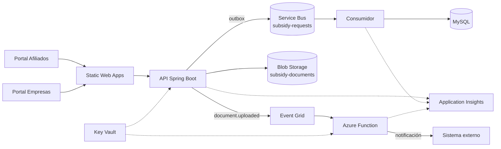

# 10 · Tecnologías de Azure en la prueba técnica

Inventario único de los servicios de Azure que intervienen en el prototipo: para qué se usan, qué
contrato exponen, con qué se sustituyen en local y en qué estado están. Si un servicio no aparece aquí,
no forma parte del alcance.

> Nada de esto se ejecutó contra una suscripción real. La prueba corre en local con adaptadores; los
> servicios de Azure son el destino previsto y su configuración está versionada como ejemplo.

## 10.1 Para qué se usa Azure

| Necesidad | Servicio | Por qué no se resuelve en el backend |
|-----------|----------|--------------------------------------|
| Procesar tareas lentas fuera de la petición HTTP | Service Bus + consumidor | El afiliado no debe esperar la clasificación documental |
| Notificar a sistemas externos un documento cargado | Event Grid + Function | Desacopla el upload de los suscriptores |
| Guardar evidencias fuera de la base | Blob Storage | Los binarios no pertenecen a MySQL |
| Persistir el estado transaccional | Azure Database for MySQL | Es el motor relacional del dominio; en local corre como contenedor y en Azure como servidor flexible |
| Validar y notificar sin mantener servidores | Azure Functions | Carga esporádica, costo por ejecución |
| Publicar los portales | Static Web Apps | CDN y ruteo sin servidor |
| Custodiar secretos | Key Vault | El repositorio no puede contener cadenas de conexión |
| Observar el flujo completo | Application Insights | Correlacionar API, Function y consumidor |

## 10.2 Mapa de servicios



## 10.3 Matriz de intervención

| Servicio | Rol en la prueba | Disparador / binding | Contrato | Sustituto local | Propiedad de conmutación | Estado | Free tier |
|---|---|---|---|---|---|---|---|
| **Service Bus** | Cola de trabajo `subsidy-requests` para clasificar solicitudes y recalcular documentos | Outbox → `ServiceBusSenderClient`; consumidor `ServiceBusProcessorClient` | `DomainEventEnvelope` en JSON, `messageId` = id del outbox | Publicador en proceso + pipeline Reactor | `app.messaging.transport=local\|azure` | Parcial: adaptadores escritos, sin broker real | No: sin cuota gratuita |
| **Azure Functions** | Validación de documentos y envío de notificaciones | HTTP trigger (backend) y Service Bus trigger (previsto) | JSON con `notificationId`, `requestId`, `correlationId` | `LocalLoggingNotificationGateway` | `app.notifications.provider=local-log\|azure-function` | Parcial: solo el cliente HTTP; la Function no existe | Sí, permanente: 1 M de ejecuciones y 400 000 GB-s al mes |
| **Event Grid** | Aviso `document.uploaded` a suscriptores | Topic custom, CloudEvent 1.0 | `type`, `subject`, `data.documentId`, `data.requestId` | Logger estructurado | `app.integrations.event-grid.enabled` (prevista) | Pendiente | Sí, permanente: 100 000 operaciones al mes |
| **Blob Storage** | Evidencias de la solicitud en contenedor privado | SDK `BlobContainerClient` | Clave opaca `{requestId}/{uuid}.{ext}`, checksum SHA-256, content-type validado | `LocalFileSystemDocumentStorage` en `target/document-storage` | `app.storage.provider=local\|azure` | Parcial: adaptador escrito, sin cuenta real | No: sin cuota gratuita |
| **Table Storage** | No se usa | — | — | — | — | **Fuera de alcance** (ver 10.9) | No aplica: fuera de alcance |
| **Static Web Apps** | Publicación de shell y remotos | Deploy de `dist/` por pipeline | `staticwebapp.config.json` con fallback de rutas | `ng serve` en 4200 / 4201 / 4202 | Scripts npm | Pendiente | Sí, plan Free: 100 GB de banda al mes |
| **Key Vault** | Secretos de conexión y clave JWT | Referencia desde App Service y Function | Nombres de secreto por entorno | Variables de entorno / `.env` no versionado | `AZURE_KEY_VAULT_URI` (prevista) | Pendiente | No: se factura por operaciones |
| **Azure Database for MySQL Flexible Server** | Persistencia transaccional del dominio y del historial; Flyway versiona el esquema | JDBC con Hikari (`mysql-connector-j`) y migraciones con `flyway-mysql` | Esquema versionado en `db/migration`; TLS obligatorio (`sslMode=REQUIRED`) fuera de local | Contenedor `mysql:8.4` en `docker-compose` | `DB_URL`, `DB_USERNAME`, `DB_PASSWORD` | Pendiente: solo contenedor local, sin servidor real | Sí, pero solo 12 meses: 750 h B1MS y 32 GB en cuentas nuevas |
| **Application Insights** | Trazas correlacionadas de API, consumidor y Function | Agente/SDK | `operation_Id` = `correlationId` | Logs con MDC `correlationId` | `APPLICATIONINSIGHTS_CONNECTION_STRING` | Pendiente | Sí, parcial: 5 GB de ingesta al mes |

## 10.4 Requisitos de integración

| ID | Requisito | Prioridad | Criterio de aceptación |
|----|-----------|-----------|------------------------|
| FR-AZR-01 | Todo mensaje publicado lleva `messageId` estable igual al id del registro de outbox | M | Reenviar el mismo outbox produce el mismo `messageId` y el consumidor lo descarta por idempotencia |
| FR-AZR-02 | Entrega al menos una vez con un máximo de 3 intentos y retroceso exponencial | M | Un fallo transitorio se reintenta; al agotar intentos el mensaje queda en `failed_message` y se completa en el broker para evitar bucles |
| FR-AZR-03 | La carga de un documento publica un CloudEvent en Event Grid | S | El evento contiene `documentId`, `requestId` y `correlationId`; sin suscriptor el upload no falla |
| FR-AZR-04 | El contenedor de evidencias es privado y la descarga solo ocurre vía API con control de propiedad | M | Un afiliado no puede leer el documento de otro; la URL del blob no se expone al cliente |
| FR-AZR-05 | La Function de notificaciones es idempotente por `notificationId` | S | Invocarla dos veces con el mismo id no genera dos envíos |
| FR-AZR-06 | El adaptador local y el de Azure respetan el mismo contrato | M | La misma prueba de integración pasa con `local` y con un doble del SDK; el handler no cambia |
| FR-AZR-07 | Sin secretos en el repositorio y fallo rápido si falta configuración | M | Arrancar con `transport=azure` sin cadena de conexión falla al iniciar con mensaje claro |
| FR-AZR-08 | Los portales se sirven con fallback de rutas para enlaces profundos | S | Recargar `/affiliates/requests/42` devuelve el shell y no un 404 |

## 10.5 Contrato del mensaje

El envelope es único para los dos transportes:

```json
{
  "messageId": "9f1c2d3e-4b5a-4c6d-8e7f-0a1b2c3d4e5f",
  "eventType": "subsidy.request.submitted",
  "aggregateType": "SubsidyRequest",
  "aggregateId": "42",
  "occurredAt": "2026-10-20T16:42:07Z",
  "correlationId": "b1e2f3a4-5c6d-7e8f-9a0b-1c2d3e4f5a6b",
  "payload": "{\"requestId\":42,\"affiliateId\":7,\"subsidyType\":\"VIVIENDA\"}"
}
```

Limitación conocida: `payload` viaja como **cadena JSON** dentro del envelope, lo que produce doble
codificación y complica la lectura en herramientas del broker. La corrección prevista es declararlo
como objeto (`JsonNode`) manteniendo compatibilidad con los mensajes ya publicados.

## 10.6 Contrato del documento

| Atributo | Regla |
|----------|-------|
| Clave | `{requestId}/{uuid}.{ext}`; el cliente nunca la elige |
| Tipo permitido | `application/pdf`, `image/png`, `image/jpeg` |
| Tamaño máximo | 5 MB (configurable) |
| Integridad | SHA-256 calculado en streaming y almacenado en MySQL |
| Acceso | Contenedor privado; descarga mediante endpoint con `AccessGuard` |
| Nombre original | Se conserva solo como metadato, saneado |

## 10.7 Fallos, reintentos y cola de fallidos

1. El consumidor comprueba idempotencia por `(messageId, consumer)` antes de ejecutar.
2. Si el handler falla, Reactor reintenta con `Retry.backoff` hasta `max-attempts`.
3. Agotados los intentos, se guarda el mensaje en `failed_message` con la causa y se completa el mensaje en el broker: se prefiere un registro consultable a un bucle de reentrega.
4. El back-office puede reintentar desde `GET /api/v1/ops/failed-messages` cuando la causa esté corregida.

## 10.8 Paridad local ↔ Azure

| Aspecto | Local | Azure | Cómo se demuestra |
|---------|-------|--------|-------------------|
| Mensajería | Publicador en proceso | Service Bus | Misma clase `SubsidyMessageHandler`; prueba con doble del sender |
| Documentos | Sistema de archivos | Blob | Misma interfaz `DocumentStorage`; contrato de checksum y content-type |
| Notificaciones | Log estructurado | Function HTTP | Mismo `NotificationGateway`; prueba con `MockWebServer` |
| Eventos | Log | Event Grid | Pendiente de implementar el adaptador |
| Secretos | Variables de entorno | Key Vault | Misma resolución de propiedades |

## 10.9 Servicios evaluados y descartados

| Servicio | Decisión | Motivo |
|----------|----------|--------|
| Table Storage | Descartado | El caso usa MySQL como relacional y Blob para binarios; añadir Table sería duplicar persistencia sin necesidad |
| Container Apps | Descartado | App Service con contenedor cubre el requisito con menos piezas; el JD pide Docker y pipelines, no orquestación |
| Azure Container Registry | Previsto, no confirmado | Solo es necesario si el pipeline publica imágenes; se decide en Fase 6 |
| Logic Apps | Descartado | La orquestación requerida cabe en Functions y Service Bus |
| Cosmos DB | Descartado | No aporta al modelo relacional de la prueba |

## 10.10 Estado y evidencia en el código

| Pieza | Archivo | Estado |
|-------|---------|--------|
| Envelope | `messaging/domain/DomainEventEnvelope.java` | Escrito |
| Publicador Service Bus | `messaging/transport/AzureServiceBusDomainEventPublisher.java` | Escrito, sin ejecutar |
| Consumidor Service Bus | `messaging/transport/AzureServiceBusConsumerConfig.java` | Escrito, sin ejecutar |
| Publicador local | `messaging/transport/LocalDomainEventPublisher.java` | Escrito, sin ejecutar |
| Blob | `storage/AzureBlobDocumentStorage.java` | Escrito, sin ejecutar |
| Almacenamiento local | `storage/LocalFileSystemDocumentStorage.java` | Escrito, sin ejecutar |
| Function de notificaciones (cliente) | `notification/application/AzureFunctionNotificationGateway.java` | Escrito, sin ejecutar |
| Function (servidor) | — | Pendiente |
| Event Grid | — | Pendiente |
| Bicep / pipeline | — | Pendiente |

## 10.11 Configuración por entorno

| Variable | Uso | Valor por defecto |
|----------|-----|-------------------|
| `MESSAGING_TRANSPORT` | `local` o `azure` | `local` |
| `AZURE_SERVICE_BUS_CONNECTION_STRING` | Conexión al namespace | vacío |
| `AZURE_SERVICE_BUS_QUEUE` | Nombre de cola | `subsidy-requests` |
| `STORAGE_PROVIDER` | `local` o `azure` | `local` |
| `AZURE_STORAGE_CONNECTION_STRING` | Cuenta de almacenamiento | vacío |
| `AZURE_STORAGE_CONTAINER` | Contenedor privado | `subsidy-documents` |
| `NOTIFICATION_PROVIDER` | `local-log` o `azure-function` | `local-log` |
| `AZURE_FUNCTION_BASE_URL` | Endpoint de la Function | `http://localhost:7071` |
| `AZURE_FUNCTION_KEY` | Clave de función | vacío |

## 10.12 Qué falta para desplegar

1. Provisionar con Bicep: Storage, Service Bus, Event Grid topic, Function App, App Service, Static Web App, Key Vault, Application Insights.
2. Publicar la Function de notificaciones y la de validación documental.
3. Configurar identidad administrada y referencias de Key Vault en lugar de cadenas de conexión.
4. Añadir el pipeline de Azure DevOps con etapas de build, pruebas, imagen y despliegue.
5. Ejecutar una prueba de humo contra el entorno desplegado y registrar la evidencia.

Mientras eso no ocurra, el estado es **parcial** y así se declara en la matriz de cobertura del JD
(documento 09).
