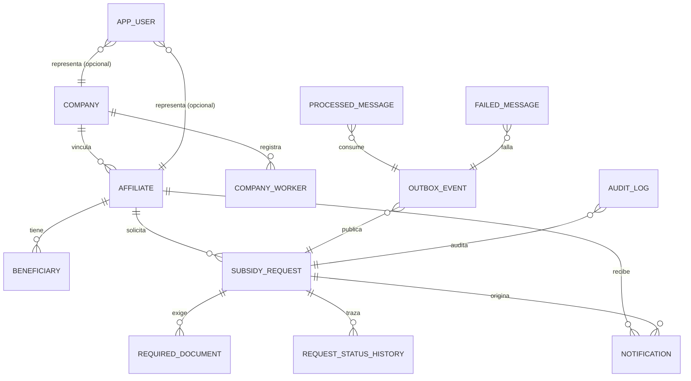

# 11 · Diccionario de datos y modelo entidad-relación

Detalle del modelo relacional del prototipo: qué tablas existen, qué guarda cada columna, qué
restricciones la protegen y qué columnas contienen datos personales. El diagrama de arquitectura del
documento 04 muestra el modelo en contexto; **este documento es la fuente de verdad del esquema**.

> Derivado de las 13 entidades JPA de `backend/src/main/java/.../**/domain` y contrastado con las
> migraciones Flyway `V1`–`V3` de `backend/src/main/resources/db/migration`, que ya existen. A partir de
> ahora **el DDL es la fuente de verdad**: si hay divergencia, manda la migración y este diccionario se
> corrige.

## 11.1 Convenciones del esquema

| Convención | Decisión | Motivo |
|------------|----------|--------|
| Nombres | `snake_case` en tablas y columnas; `camelCase` en Java | El mapeo es explícito con `@Column(name = ...)`, sin depender de la estrategia de Hibernate |
| Claves primarias | `BIGINT AUTO_INCREMENT`; `CHAR(36)` UUID en `outbox_event` | El outbox necesita un id estable generado en la aplicación antes de persistir |
| Fechas | `TIMESTAMP` en UTC (`Instant`), `DATE` para fechas sin hora | Evita ambigüedad horaria entre Bogotá y los servidores |
| Montos | `DECIMAL(14,2)` + columna `currency` | Precisión exacta; nunca `FLOAT` |
| Enumeraciones | `VARCHAR(n)` con `@Enumerated(STRING)` | Legible en la base y evolutivo sin `ALTER` del tipo |
| Marcas de tiempo | `created_at` / `updated_at` en tablas de negocio, gestionadas por la entidad | Portabilidad con H2: sin `ON UPDATE CURRENT_TIMESTAMP` |
| Concurrencia | `version BIGINT` con `@Version` en `subsidy_request` y `outbox_event` | Bloqueo optimista; dos analistas no pueden decidir a la vez |
| Borrado | Lógico por estado (`INACTIVE`, `CANCELLED`); sin `DELETE` físico | La trazabilidad y la auditoría lo exigen |
| Charset | `utf8mb4` / `utf8mb4_0900_ai_ci` | Acentos y nombres compuestos sin pérdida |

## 11.2 Modelo entidad-relación



| Relación | Cardinalidad | Regla de negocio |
|----------|--------------|------------------|
| `company` → `affiliate` | 1 : N (opcional) | Un afiliado puede no tener empresa aportante |
| `company` → `company_worker` | 1 : N | El documento es único dentro de la empresa, no en el sistema |
| `affiliate` → `beneficiary` | 1 : N | Un beneficiario pertenece a un solo afiliado |
| `affiliate` → `subsidy_request` | 1 : N | Un afiliado puede tener varias solicitudes, pero solo una abierta por tipo |
| `subsidy_request` → `required_document` | 1 : N | Un documento por tipo y solicitud (`uk_required_document_request_type`) |
| `subsidy_request` → `request_status_history` | 1 : N | Toda transición deja una fila; el historial es inmutable |
| `app_user` → `affiliate` / `company` | N : 1 (opcional) | La identidad de demostración se vincula a un afiliado, a una empresa o a ninguno (back-office) |
| `outbox_event` → `processed_message` | 1 : N | Un evento puede consumirse por varios consumidores, cada uno idempotente |
| `failed_message` | — | Copia del payload agotados los reintentos; no sustituye al outbox |

**Integridad referencial:** las relaciones se modelan con identificadores (`affiliate_id`, `request_id`)
y **no** con `@ManyToOne`. Las claves foráneas físicas se declaran en la migración, pero la aplicación
valida la pertenencia antes de escribir (`AccessGuard`). Es una decisión consciente para mantener los
agregados pequeños y evitar cargas en cascada.

## 11.3 Diccionario de datos

### 11.3.1 Identidad

**`app_user`** — credenciales de demostración. No representa el directorio corporativo real.

| Columna | Tipo | Nulo | Restricción | Descripción |
|---------|------|------|-------------|-------------|
| `id` | `BIGINT` | No | PK, autoincrement | Identificador interno |
| `username` | `VARCHAR(60)` | No | `UNIQUE` | Usuario de demostración; coincide con el `sub` del JWT |
| `password_hash` | `VARCHAR(100)` | No | — | Hash BCrypt; **nunca** la contraseña en claro |
| `role` | `VARCHAR(30)` | No | `ROLE_AFFILIATE`, `ROLE_COMPANY`, `ROLE_BACKOFFICE`, `ROLE_AUDITOR` | Autoridad que viaja en el token |
| `affiliate_id` | `BIGINT` | Sí | FK lógica → `affiliate.id` | Vínculo cuando el rol es de afiliado |
| `company_id` | `BIGINT` | Sí | FK lógica → `company.id` | Vínculo cuando el rol es de empresa |
| `created_at` | `TIMESTAMP` | No | — | Alta del usuario |

### 11.3.2 Afiliación

**`company`** — empresa aportante.

| Columna | Tipo | Nulo | Restricción | Descripción |
|---------|------|------|-------------|-------------|
| `id` | `BIGINT` | No | PK, autoincrement | Identificador interno |
| `nit` | `VARCHAR(20)` | No | `UNIQUE` | NIT con dígito de verificación; se enmascara al exponerlo |
| `legal_name` | `VARCHAR(160)` | No | — | Razón social |
| `sector` | `VARCHAR(60)` | Sí | — | Sector económico |
| `company_size` | `VARCHAR(20)` | Sí | `MICRO`, `SMALL`, `MEDIUM`, `LARGE` | Tamaño declarado |
| `city` | `VARCHAR(80)` | Sí | — | Ciudad de operación |
| `contact_email` | `VARCHAR(120)` | Sí | — | Correo de contacto; dato personal |
| `status` | `VARCHAR(20)` | No | `ACTIVE`, `INACTIVE`; por defecto `ACTIVE` | Estado de la empresa |
| `created_at` | `TIMESTAMP` | No | — | Alta |
| `updated_at` | `TIMESTAMP` | No | — | Última modificación |

**`affiliate`** — afiliado titular.

| Columna | Tipo | Nulo | Restricción | Descripción |
|---------|------|------|-------------|-------------|
| `id` | `BIGINT` | No | PK, autoincrement | Identificador interno |
| `document_type` | `VARCHAR(10)` | No | — | Tipo de documento (`CC`, `CE`, `PA`, `TI`) |
| `document_number` | `VARCHAR(30)` | No | `UNIQUE` | Documento; **dato personal**, se enmascara |
| `first_name` | `VARCHAR(80)` | No | — | Nombres |
| `last_name` | `VARCHAR(80)` | No | — | Apellidos |
| `email` | `VARCHAR(120)` | No | — | Correo; **dato personal** |
| `phone` | `VARCHAR(30)` | Sí | — | Teléfono; **dato personal** |
| `birth_date` | `DATE` | Sí | — | Fecha de nacimiento; **dato personal** |
| `category` | `VARCHAR(10)` | Sí | `A`, `B`, `C` (regla de demostración) | Categoría de afiliación |
| `company_id` | `BIGINT` | Sí | FK lógica → `company.id` | Empresa aportante |
| `status` | `VARCHAR(20)` | No | `ACTIVE`, `SUSPENDED`, `INACTIVE`; por defecto `ACTIVE` | Estado |
| `created_at` | `TIMESTAMP` | No | — | Alta |
| `updated_at` | `TIMESTAMP` | No | — | Última modificación |

**`beneficiary`** — beneficiario del afiliado.

| Columna | Tipo | Nulo | Restricción | Descripción |
|---------|------|------|-------------|-------------|
| `id` | `BIGINT` | No | PK, autoincrement | Identificador interno |
| `affiliate_id` | `BIGINT` | No | FK lógica → `affiliate.id` | Titular |
| `full_name` | `VARCHAR(160)` | No | — | Nombre completo; **dato personal** |
| `relationship` | `VARCHAR(20)` | No | `HIJO`, `CONYUGE`, `COMPANERO_PERMANENTE`, `PADRE`, `MADRE`, `HERMANO` | Parentesco |
| `document_number` | `VARCHAR(30)` | Sí | — | Documento; **dato personal**, se enmascara |
| `birth_date` | `DATE` | Sí | — | Fecha de nacimiento; **dato personal** |

**`company_worker`** — trabajador de demostración de una empresa.

| Columna | Tipo | Nulo | Restricción | Descripción |
|---------|------|------|-------------|-------------|
| `id` | `BIGINT` | No | PK, autoincrement | Identificador interno |
| `company_id` | `BIGINT` | No | FK lógica → `company.id` | Empresa |
| `document_type` | `VARCHAR(10)` | No | — | Tipo de documento |
| `document_number` | `VARCHAR(30)` | No | Único junto a `company_id` | Documento; **dato personal** |
| `first_name` | `VARCHAR(80)` | No | — | Nombres |
| `last_name` | `VARCHAR(80)` | No | — | Apellidos |
| `position` | `VARCHAR(80)` | Sí | — | Cargo |
| `hired_at` | `DATE` | Sí | — | Fecha de ingreso |
| `status` | `VARCHAR(20)` | No | `ACTIVE`, `INACTIVE`; por defecto `ACTIVE` | Estado del vínculo |
| `created_at` | `TIMESTAMP` | No | — | Alta |
| `updated_at` | `TIMESTAMP` | No | — | Última modificación |

### 11.3.3 Solicitudes

**`subsidy_request`** — agregado raíz del flujo. Es la tabla que gobierna el estado.

| Columna | Tipo | Nulo | Restricción | Descripción |
|---------|------|------|-------------|-------------|
| `id` | `BIGINT` | No | PK, autoincrement | Identificador interno; nunca se expone en la API |
| `request_number` | `VARCHAR(30)` | No | `UNIQUE` | Radicado legible que ve el afiliado |
| `affiliate_id` | `BIGINT` | No | FK lógica → `affiliate.id` | Titular que solicita |
| `company_id` | `BIGINT` | Sí | FK lógica → `company.id` | Empresa asociada al momento de radicar |
| `subsidy_type` | `VARCHAR(30)` | No | `VIVIENDA`, `EDUCACION`, `RECREACION`, `CREDITO` | Tipo de subsidio |
| `status` | `VARCHAR(30)` | No | Ver 11.4; por defecto `DRAFT` | Estado vigente |
| `requested_amount` | `DECIMAL(14,2)` | No | `> 0` (validado en `SubsidyDemoRules`) | Monto solicitado |
| `currency` | `VARCHAR(3)` | No | Por defecto `COP` | Moneda |
| `purpose` | `VARCHAR(400)` | Sí | — | Motivo declarado por el afiliado |
| `submitted_at` | `TIMESTAMP` | Sí | — | Momento de radicación |
| `decided_at` | `TIMESTAMP` | Sí | — | Momento de la decisión de demostración |
| `decision_reason` | `VARCHAR(400)` | Sí | 10–400 caracteres si hay decisión | Motivo obligatorio al decidir |
| `version` | `BIGINT` | No | `@Version` | Bloqueo optimista |
| `created_at` | `TIMESTAMP` | No | — | Alta del registro |
| `updated_at` | `TIMESTAMP` | No | — | Última modificación |

**`required_document`** — evidencia exigida y su estado.

| Columna | Tipo | Nulo | Restricción | Descripción |
|---------|------|------|-------------|-------------|
| `id` | `BIGINT` | No | PK, autoincrement | Identificador interno |
| `request_id` | `BIGINT` | No | FK lógica → `subsidy_request.id`; único junto a `document_type` | Solicitud |
| `document_type` | `VARCHAR(40)` | No | `ID_DOCUMENT`, `INCOME_CERTIFICATE`, `BANK_CERTIFICATE`, `ENROLLMENT_CERTIFICATE`, `FAMILY_COMPOSITION_CERTIFICATE` | Tipo exigido |
| `status` | `VARCHAR(20)` | No | `PENDING`, `RECEIVED`, `VALIDATED`, `REJECTED`; por defecto `PENDING` | Estado del documento |
| `file_name` | `VARCHAR(200)` | Sí | — | Nombre original saneado |
| `storage_key` | `VARCHAR(300)` | Sí | — | Clave opaca `{requestId}/{uuid}.{ext}`; nunca la ruta del afiliado |
| `content_type` | `VARCHAR(100)` | Sí | Lista permitida | MIME validado en la carga |
| `size_bytes` | `BIGINT` | Sí | ≤ 5 MB | Tamaño real |
| `checksum` | `VARCHAR(64)` | Sí | — | SHA-256 hexadecimal calculado en streaming |
| `uploaded_at` | `TIMESTAMP` | Sí | — | Momento de la carga |
| `reviewed_at` | `TIMESTAMP` | Sí | — | Momento de la revisión |
| `rejection_reason` | `VARCHAR(300)` | Sí | — | Motivo si el documento se rechaza |

**`request_status_history`** — trazabilidad inmutable de cada transición.

| Columna | Tipo | Nulo | Restricción | Descripción |
|---------|------|------|-------------|-------------|
| `id` | `BIGINT` | No | PK, autoincrement | Identificador interno |
| `request_id` | `BIGINT` | No | FK lógica → `subsidy_request.id` | Solicitud trazada |
| `from_status` | `VARCHAR(30)` | Sí | Valores de 11.4; nulo en el alta | Estado anterior |
| `to_status` | `VARCHAR(30)` | No | Valores de 11.4 | Estado nuevo |
| `reason` | `VARCHAR(400)` | Sí | — | Motivo del cambio |
| `actor` | `VARCHAR(80)` | No | — | Quién ejecutó la transición (`username` o `system:subsidy-consumer`) |
| `correlation_id` | `VARCHAR(64)` | Sí | — | Hilo de correlación del request |
| `occurred_at` | `TIMESTAMP` | No | — | Momento del cambio |

**`notification`** — bandeja in-app del afiliado.

| Columna | Tipo | Nulo | Restricción | Descripción |
|---------|------|------|-------------|-------------|
| `id` | `BIGINT` | No | PK, autoincrement | Identificador interno |
| `affiliate_id` | `BIGINT` | No | FK lógica → `affiliate.id` | Destinatario |
| `request_id` | `BIGINT` | Sí | FK lógica → `subsidy_request.id` | Solicitud que la origina |
| `channel` | `VARCHAR(20)` | No | `IN_APP`, `EMAIL_DEMO`; por defecto `IN_APP` | Canal; `EMAIL_DEMO` se registra, no se envía |
| `subject` | `VARCHAR(160)` | No | — | Asunto |
| `body` | `VARCHAR(1000)` | No | — | Cuerpo; sin datos personales completos |
| `read_flag` | `BOOLEAN` | No | — | Leída o no (la columna no se llama `read` por ser palabra reservada) |
| `created_at` | `TIMESTAMP` | No | — | Alta |

### 11.3.4 Mensajería y auditoría

**`outbox_event`** — outbox transaccional. Se escribe en la misma transacción que el agregado.

| Columna | Tipo | Nulo | Restricción | Descripción |
|---------|------|------|-------------|-------------|
| `id` | `CHAR(36)` | No | PK, UUID generado en la aplicación | Es también el `messageId` del envelope |
| `aggregate_type` | `VARCHAR(40)` | No | — | `SubsidyRequest`, `Document`, … |
| `aggregate_id` | `VARCHAR(40)` | No | — | Id del agregado afectado |
| `event_type` | `VARCHAR(80)` | No | — | `subsidy.request.submitted`, `subsidy.document.uploaded`, … |
| `payload` | `VARCHAR(4000)` | No | — | Envelope serializado |
| `status` | `VARCHAR(20)` | No | `PENDING`, `PUBLISHED`, `FAILED`; por defecto `PENDING` | Estado de publicación |
| `attempts` | `INT` | No | — | Intentos de publicación |
| `correlation_id` | `VARCHAR(64)` | Sí | — | Correlación extremo a extremo |
| `created_at` | `TIMESTAMP` | No | — | Momento de creación |
| `published_at` | `TIMESTAMP` | Sí | — | Momento de publicación efectiva |
| `last_error` | `VARCHAR(500)` | Sí | — | Último error de publicación |
| `version` | `BIGINT` | No | `@Version` | Evita que dos publicadores tomen la misma fila |

**`processed_message`** — libro de idempotencia del consumidor.

| Columna | Tipo | Nulo | Restricción | Descripción |
|---------|------|------|-------------|-------------|
| `id` | `BIGINT` | No | PK, autoincrement | Identificador interno |
| `message_id` | `CHAR(36)` | No | Único junto a `consumer` (`uk_processed_message_id_consumer`) | Id del mensaje ya procesado |
| `consumer` | `VARCHAR(80)` | No | Único junto a `message_id` | Consumidor que lo procesó |
| `outcome` | `VARCHAR(30)` | No | `PROCESSED`, `IGNORED` | Resultado registrado |
| `processed_at` | `TIMESTAMP` | No | — | Momento del procesamiento |

**`failed_message`** — dead letter local tras agotar reintentos.

| Columna | Tipo | Nulo | Restricción | Descripción |
|---------|------|------|-------------|-------------|
| `id` | `BIGINT` | No | PK, autoincrement | Identificador interno |
| `message_id` | `CHAR(36)` | No | — | Mensaje que falló |
| `consumer` | `VARCHAR(80)` | No | — | Consumidor que agotó los intentos |
| `event_type` | `VARCHAR(80)` | Sí | — | Tipo de evento |
| `payload` | `VARCHAR(4000)` | Sí | — | Copia del envelope para reproceso manual |
| `error` | `VARCHAR(1000)` | Sí | — | Último error |
| `attempts` | `INT` | No | — | Intentos consumidos |
| `failed_at` | `TIMESTAMP` | No | — | Momento del fallo definitivo |
| `resolved` | `BOOLEAN` | No | — | Si ya se reprocesó o se descartó |

**`audit_log`** — auditoría append-only de accesos y decisiones.

| Columna | Tipo | Nulo | Restricción | Descripción |
|---------|------|------|-------------|-------------|
| `id` | `BIGINT` | No | PK, autoincrement | Identificador interno |
| `actor` | `VARCHAR(80)` | No | — | Quién ejecutó la acción |
| `action` | `VARCHAR(60)` | No | Valores de `AuditActions` | `PII_ACCESS`, `SUBSIDY_DECISION`, `LOGIN_FAILED`, … |
| `entity_type` | `VARCHAR(50)` | Sí | — | Tipo de entidad afectada |
| `entity_id` | `VARCHAR(50)` | Sí | — | Id afectado |
| `correlation_id` | `VARCHAR(64)` | Sí | — | Correlación con el request |
| `details` | `VARCHAR(1000)` | Sí | — | Detalle saneado; sin datos personales completos |
| `ip_address` | `VARCHAR(45)` | Sí | — | IPv4 o IPv6; dato personal de contexto |
| `occurred_at` | `TIMESTAMP` | No | — | Momento del evento |

## 11.4 Enumeraciones y máquina de estados

Los enums se persisten como texto: si mañana aparece un valor nuevo, la migración es un `ALTER` de
longitud, no un cambio de tipo.

| Enum | Valores | Columna | Longitud |
|------|---------|---------|----------|
| `AffiliateStatus` | `ACTIVE`, `SUSPENDED`, `INACTIVE` | `affiliate.status` | 20 |
| `CompanyStatus` | `ACTIVE`, `INACTIVE` | `company.status` | 20 |
| `WorkerStatus` | `ACTIVE`, `INACTIVE` | `company_worker.status` | 20 |
| `CompanySize` | `MICRO`, `SMALL`, `MEDIUM`, `LARGE` | `company.company_size` | 20 |
| `Relationship` | `HIJO`, `CONYUGE`, `COMPANERO_PERMANENTE`, `PADRE`, `MADRE`, `HERMANO` | `beneficiary.relationship` | 20 |
| `SubsidyType` | `VIVIENDA`, `EDUCACION`, `RECREACION`, `CREDITO` | `subsidy_request.subsidy_type` | 30 |
| `SubsidyRequestStatus` | `DRAFT`, `SUBMITTED`, `PENDING_DOCUMENTS`, `IN_REVIEW`, `APPROVED_DEMO`, `REJECTED_DEMO`, `CANCELLED` | `subsidy_request.status` | 30 |
| `DocumentType` | `ID_DOCUMENT`, `INCOME_CERTIFICATE`, `BANK_CERTIFICATE`, `ENROLLMENT_CERTIFICATE`, `FAMILY_COMPOSITION_CERTIFICATE` | `required_document.document_type` | 40 |
| `DocumentStatus` | `PENDING`, `RECEIVED`, `VALIDATED`, `REJECTED` | `required_document.status` | 20 |
| `OutboxStatus` | `PENDING`, `PUBLISHED`, `FAILED` | `outbox_event.status` | 20 |
| `Role` | `ROLE_AFFILIATE`, `ROLE_COMPANY`, `ROLE_BACKOFFICE`, `ROLE_AUDITOR` | `app_user.role` | 30 |
| `NotificationChannel` | `IN_APP`, `EMAIL_DEMO` | `notification.channel` | 20 |

**Transiciones de `subsidy_request.status`.** La tabla replica `SubsidyRequest.ALLOWED_TRANSITIONS`;
una transición fuera de esta matriz devuelve `422 INVALID_STATUS_TRANSITION`.

| Desde | Hacia | Disparador |
|-------|-------|------------|
| `DRAFT` | `SUBMITTED` | Radicación del afiliado |
| `SUBMITTED` | `PENDING_DOCUMENTS` | El consumidor detecta evidencias faltantes |
| `SUBMITTED` | `IN_REVIEW` | El consumidor detecta la evidencia completa |
| `SUBMITTED` | `CANCELLED` | Cancelación del afiliado |
| `PENDING_DOCUMENTS` | `IN_REVIEW` | Carga del último documento requerido |
| `PENDING_DOCUMENTS` | `CANCELLED` | Cancelación del afiliado |
| `IN_REVIEW` | `PENDING_DOCUMENTS` | Rechazo de un documento en la revisión |
| `IN_REVIEW` | `APPROVED_DEMO` | Decisión de demostración del back-office |
| `IN_REVIEW` | `REJECTED_DEMO` | Decisión de demostración del back-office |
| `IN_REVIEW` | `CANCELLED` | Cancelación antes de decidir |
| `APPROVED_DEMO` | — | Estado terminal |
| `REJECTED_DEMO` | — | Estado terminal |
| `CANCELLED` | — | Estado terminal |

Los nombres `APPROVED_DEMO` y `REJECTED_DEMO` son deliberados: **ninguna decisión del prototipo
equivale a una aprobación real de subsidio** (regla RD-01 del documento 01).

## 11.5 Índices y restricciones

| Tabla | Nombre | Columnas | Tipo | Origen |
|-------|--------|----------|------|--------|
| `app_user` | `uk_app_user_username` | `username` | Único | Entidad |
| `company` | `uk_company_nit` | `nit` | Único | Entidad |
| `affiliate` | `uk_affiliate_document` | `document_number` | Único | Entidad |
| `affiliate` | `idx_affiliate_company_status` | `company_id`, `status` | Índice | Migración (pendiente) |
| `company_worker` | `uk_worker_company_document` | `company_id`, `document_number` | Único | Migración (pendiente) |
| `subsidy_request` | `uk_request_number` | `request_number` | Único | Entidad |
| `subsidy_request` | `idx_request_affiliate_status` | `affiliate_id`, `status` | Índice | Migración (pendiente) |
| `subsidy_request` | `idx_request_company_status` | `company_id`, `status` | Índice | Migración (pendiente) |
| `subsidy_request` | `idx_request_submitted_at` | `submitted_at` | Índice | Migración (pendiente) |
| `required_document` | `uk_required_document_request_type` | `request_id`, `document_type` | Único | Entidad |
| `request_status_history` | `idx_history_request_occurred` | `request_id`, `occurred_at` | Índice | Migración (pendiente) |
| `notification` | `idx_notification_affiliate_read` | `affiliate_id`, `read_flag` | Índice | Migración (pendiente) |
| `outbox_event` | `idx_outbox_status_created` | `status`, `created_at` | Índice | Migración (pendiente) |
| `processed_message` | `uk_processed_message_id_consumer` | `message_id`, `consumer` | Único | Entidad |
| `failed_message` | `idx_failed_resolved_at` | `resolved`, `failed_at` | Índice | Migración (pendiente) |
| `audit_log` | `idx_audit_occurred` | `occurred_at` | Índice | Migración (pendiente) |
| `audit_log` | `idx_audit_entity` | `entity_type`, `entity_id` | Índice | Migración (pendiente) |
| `audit_log` | `idx_audit_action` | `action` | Índice | Migración (pendiente) |

«Entidad» significa que la restricción ya está declarada en el código (`unique = true` o
`@UniqueConstraint`) y Hibernate la conoce. «Migración (pendiente)» son índices de rendimiento que solo
existen en el diseño: **no están creados en ninguna parte**, porque no hay migraciones todavía.

Tres índices merecen justificación explícita:

- `uk_processed_message_id_consumer` es el mecanismo de idempotencia. Sin ese único, un reenvío del
  broker produce doble efecto y la garantía «al menos una vez» se convierte en «al menos dos».
- `idx_outbox_status_created` sostiene el publicador, que consulta `PENDING` ordenado por antigüedad.
- `idx_request_affiliate_status` resuelve el listado del portal y la regla «una solicitud abierta por
  tipo» sin recorrer la tabla.

## 11.6 Integridad, concurrencia y retención

| Aspecto | Regla |
|---------|-------|
| Claves foráneas | Se declaran en la migración con `ON DELETE RESTRICT`; la aplicación nunca borra en cascada |
| Borrado | No hay `DELETE` físico de solicitudes ni de historial. `CANCELLED` e `INACTIVE` son estados |
| Concurrencia | `subsidy_request.version` y `outbox_event.version` con bloqueo optimista; el segundo analista recibe `409` |
| Transaccionalidad | Solicitud + documentos + historial + evento de outbox se escriben en **una** transacción |
| Retención | `outbox_event` publicados: 7 días. `processed_message`: 30 días. `failed_message` resueltos: 90 días. `audit_log`: sin purga automática |
| Purga | Tarea programada en Fase 5; hoy no existe |

## 11.7 Datos personales y enmascarado

El prototipo **no contiene datos reales**: la carga inicial es sintética. Aun así, el modelo se trata
como si lo fueran, porque el objetivo es demostrar el control.

| Columna | Clasificación | Cómo se expone |
|---------|---------------|----------------|
| `affiliate.document_number` | Personal identificable | Enmascarado: `****1234` |
| `affiliate.email` | Personal identificable | Enmascarado: `a***@dominio.com` |
| `affiliate.phone` | Personal identificable | Enmascarado: `*** *** 45` |
| `affiliate.first_name`, `last_name` | Personal | Visibles solo al titular y al back-office autorizado |
| `affiliate.birth_date` | Personal | Visible al titular; en reportes se usa solo el rango de edad |
| `beneficiary.full_name`, `document_number`, `birth_date` | Personal de tercero | Enmascarado en la API de empresa; visible al afiliado titular |
| `company_worker.document_number`, `first_name`, `last_name` | Personal | Visible a la empresa propietaria; enmascarado fuera de ella |
| `company.contact_email`, `company.nit` | Corporativo con dato de contacto | NIT con dígito de verificación enmascarado |
| `app_user.password_hash` | Secreto | Nunca sale de la base |
| `audit_log.ip_address` | Personal de contexto | No se expone por API; solo consulta de auditoría |
| `required_document.storage_key` | Metadato sensible | No se expone: la descarga pasa por la API con control de propiedad |

El enmascarado ocurre en el mapper del DTO (`MaskingUtils`), no en la consulta. Así, un error de mapeo
produce un `500` y no una fuga de datos en claro.

## 11.8 Correspondencia tabla ↔ módulo ↔ caso de uso

| Tabla | Módulo | Casos de uso |
|-------|--------|--------------|
| `app_user` | `auth` | Todos (autenticación) |
| `company` | `company` | UC-08, UC-09, UC-10, UC-11 |
| `affiliate` | `affiliate` | UC-01, UC-02, UC-03 |
| `beneficiary` | `affiliate` | UC-02, UC-03 |
| `company_worker` | `company` | UC-09, UC-11 |
| `subsidy_request` | `subsidy` | UC-03, UC-05, UC-06, UC-10, UC-11, UC-12 |
| `required_document` | `subsidy` | UC-04, UC-12 |
| `request_status_history` | `subsidy` | UC-05, UC-12, UC-13 |
| `notification` | `notification` | UC-07, UC-13 |
| `outbox_event` | `messaging` | UC-03, UC-04, UC-12, UC-13 |
| `processed_message` | `messaging` | UC-13 |
| `failed_message` | `messaging` | UC-13 |
| `audit_log` | `audit` | Transversal (accesos, decisiones, fallos) |

## 11.9 Migraciones

Flyway está configurado (`flyway-core` + `flyway-mysql`, `ddl-auto: none`, `baseline-on-migrate: false`)
y las tres migraciones están escritas en `backend/src/main/resources/db/migration`:

- `V1__esquema_inicial.sql` — las 13 tablas con sus claves primarias, únicas y foráneas.
- `V2__indices_de_consulta.sql` — los índices de consulta del §11.5.
- `V3__datos_sinteticos.sql` — datos de demostración: empresas, afiliados, beneficiarios, trabajadores,
  solicitudes en tres estados, documentos, historial, notificaciones, outbox, idempotencia y auditoría.

La semilla **no** crea filas en `app_user`: la contraseña debe ser un hash BCrypt real, y ese sembrado
corresponde al `DemoUserInitializer`, que sigue pendiente (brecha B4 del [documento 07](07-inventario-codigo-preliminar.md)).

| Convención | Valor |
|------------|-------|
| Ubicación | `backend/src/main/resources/db/migration` |
| Nombres | `V1__esquema_inicial.sql`, `V2__indices_de_consulta.sql`, `V3__datos_sinteticos.sql` |
| Cambios repetibles | `R__vista_resumen.sql` para vistas y funciones |
| Semilla | `V3` con datos sintéticos; nunca en `V1` |
| Rollback | Migración compensatoria nueva; no se usa `flyway undo` (solo disponible en Teams) |
| Verificación | `mvn flyway:validate` en CI antes de empaquetar |
| H2 | Mismo DDL donde sea posible; las diferencias de dialecto se aíslan en un `application-test.yml` |

Extracto de `V1` para `subsidy_request`, que es el DDL que se aplica:

```sql
CREATE TABLE subsidy_request (
    id                BIGINT        NOT NULL AUTO_INCREMENT,
    request_number    VARCHAR(30)   NOT NULL,
    affiliate_id      BIGINT        NOT NULL,
    company_id        BIGINT        NULL,
    subsidy_type      VARCHAR(30)   NOT NULL,
    status            VARCHAR(30)   NOT NULL DEFAULT 'DRAFT',
    requested_amount  DECIMAL(14,2) NOT NULL,
    currency          VARCHAR(3)    NOT NULL DEFAULT 'COP',
    purpose           VARCHAR(400)  NULL,
    submitted_at      TIMESTAMP     NULL,
    decided_at        TIMESTAMP     NULL,
    decision_reason   VARCHAR(400)  NULL,
    version           BIGINT        NOT NULL DEFAULT 0,
    created_at        TIMESTAMP     NOT NULL,
    updated_at        TIMESTAMP     NOT NULL,
    PRIMARY KEY (id),
    UNIQUE KEY uk_request_number (request_number),
    KEY idx_request_affiliate_status (affiliate_id, status),
    KEY idx_request_company_status (company_id, status),
    CONSTRAINT fk_request_affiliate FOREIGN KEY (affiliate_id) REFERENCES affiliate (id)
) ENGINE=InnoDB DEFAULT CHARSET=utf8mb4 COLLATE=utf8mb4_0900_ai_ci;
```

## 11.10 Lo que falta para que este modelo sea ejecutable

| Pendiente | Impacto |
|-----------|---------|
| Historial de Flyway sin inicializar si la base se creó a mano | `flyway:baseline` en la versión 3 antes de arrancar con migraciones activas |
| `beneficiary` sin `created_at`/`updated_at` | Inconsistente con el resto de tablas de negocio; decidir si se añaden |
| Sin restricciones `CHECK` en `requested_amount > 0` y longitudes de motivo | La validación vive solo en la capa de aplicación |
| `app_user` sin semilla | No hay usuarios de demostración hasta que exista el `DemoUserInitializer` |
| Sin prueba de integración contra MySQL real | H2 no valida el DDL específico del motor (ver 11.9) |
| Los índices de `V2` no se han medido con datos de volumen | El diseño es razonable, pero no hay evidencia de rendimiento |

Estos puntos están alineados con las brechas B1–B7 del [documento 07](07-inventario-codigo-preliminar.md)
y con la Fase 2 del [plan de entrega](06-plan-entrega.md).
