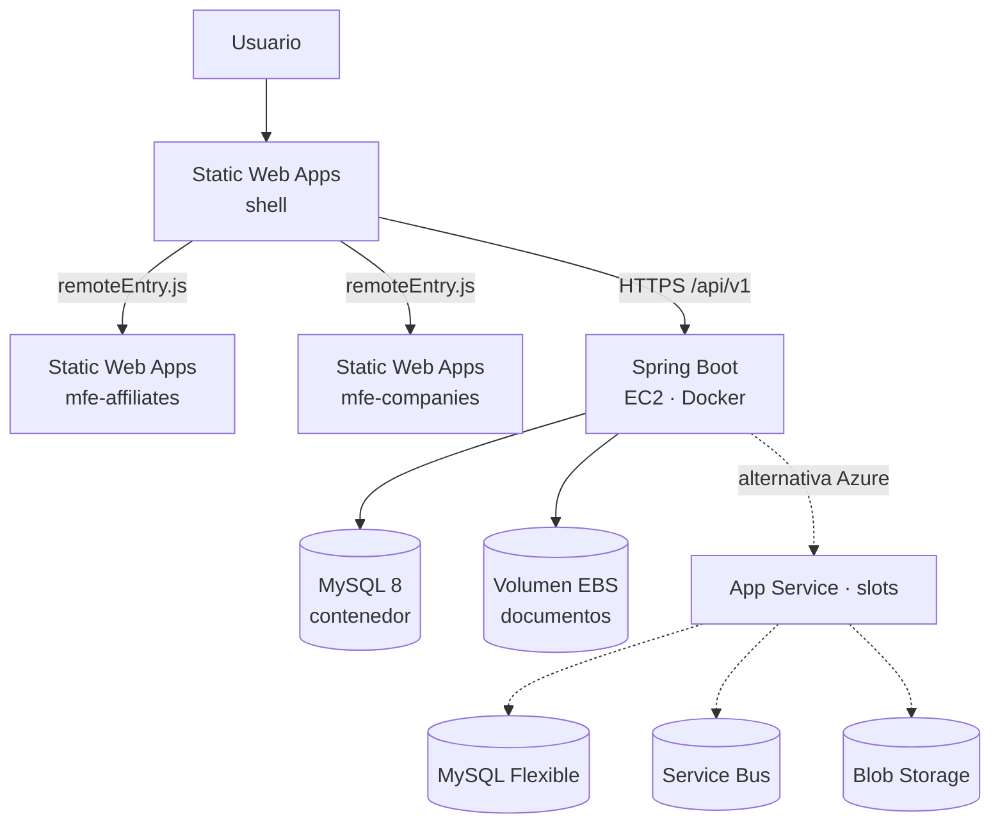
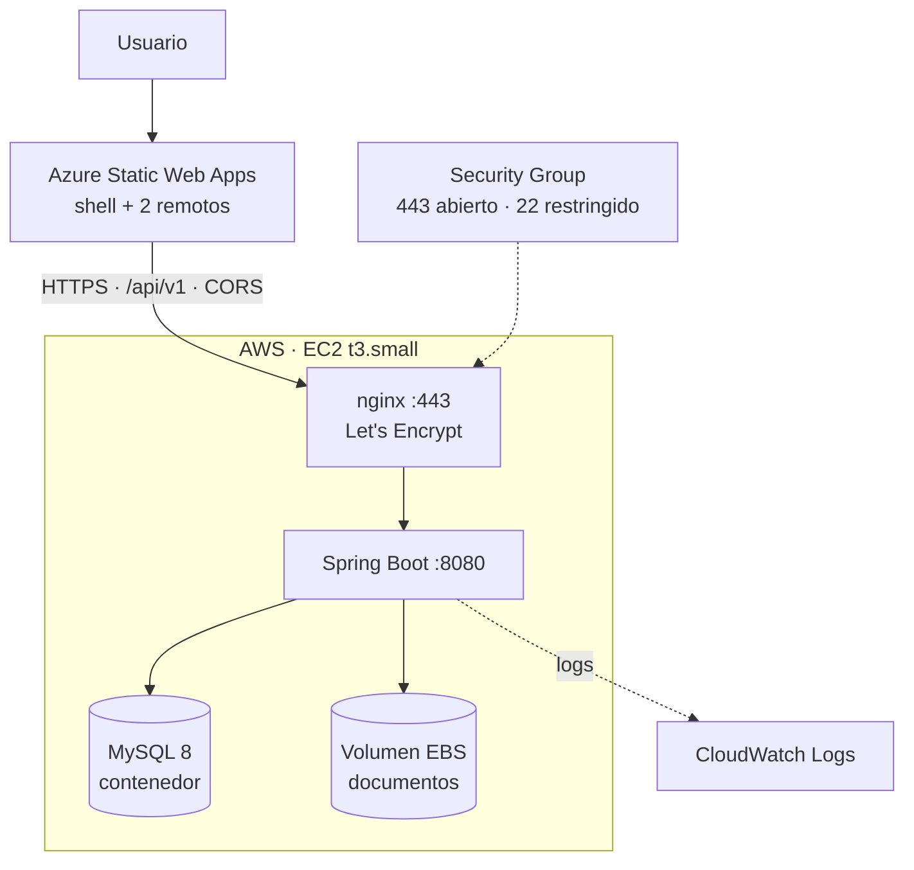

# 12 · Plan de despliegue: microfrontends en Azure y backend en AWS

Cómo se publica el prototipo cuando exista: qué artefactos se generan, dónde aterrizan, en qué orden se
promueven y cómo se revierte. El diseño de microfrontends del documento 04 (§4.8) ya decidió tres cosas
que aquí se materializan: **tres aplicaciones independientes**, un **manifiesto de remotos leído en
runtime** y un **`contractVersion` que el shell valida** antes de montar una ruta.

**Topología vigente (2026-10-20):** el frontend se publica en tres Static Web Apps de Azure y el backend
en una instancia **AWS EC2** con Docker Compose. App Service queda documentado como alternativa para
cuando se exija que todo el sistema viva en Azure. El detalle de la decisión, con lo que se gana y lo que
se deja de demostrar, está en la [sección 12.16](#1216-topologia-vigente-backend-en-aws-ec2).

> **Nada de este documento se ha ejecutado.** No hay suscripción, ni `frontend/`, ni `infra/`, ni
> pipeline: la Fase 6 del [plan de entrega](06-plan-entrega.md) es la que los crea. Los nombres de
> recurso y las cifras son de ejemplo, y todo el flujo sigue funcionando en local sin Azure.

## 12.1 Estado actual

| Pieza | Existe hoy | Consecuencia |
|-------|------------|--------------|
| `backend/` | Sí: 92 archivos Java, `pom.xml`, `application.yml` | Comila como proyecto Maven, pero sin migraciones Flyway no arranca contra MySQL |
| `frontend/` | **No existe** | El shell y los dos remotos son diseño, no código |
| `infra/` (Bicep) | **No existe** | No hay infraestructura como código |
| Pipeline | **No existe** | Ningún despliegue automatizado |
| `docker-compose.yml` | **No existe** | El entorno local se levanta a mano |
| Topología elegida | Frontend en Azure, backend en EC2 | El `docker-compose.yml` deja de ser solo local: es también el artefacto de despliegue |

Por eso este plan es prospectivo: describe el destino y el orden, no un estado alcanzado.

## 12.2 Topología de despliegue



Línea continua: **topología vigente**. Línea punteada: **alternativa en Azure**, que se activa cambiando
las variables de entorno del backend y publicándolo en App Service.

Los artefactos se agrupan en tres planos: **estático** (tres Static Web Apps), **cómputo** (la API) y
**datos** (MySQL y el volumen de evidencias). Se despliegan por separado porque fallan por razones
distintas. En la topología vigente no hay Service Bus, ni Blob, ni Function: el
backend usa los adaptadores locales —outbox en proceso y sistema de archivos— y por eso el
`docker-compose.yml` es a la vez entorno local y artefacto de despliegue.

> **Por qué EC2 y qué cuesta:** está en la [sección 12.16](#1216-topologia-vigente-backend-en-aws-ec2).
> En una línea: cuesta menos y se levanta más rápido, pero deja sin evidencia los requisitos de
> integración con Azure del perfil.

## 12.3 Unidades de despliegue

| Artefacto | Se construye con | Destino | Versionado | Frecuencia |
|-----------|------------------|---------|------------|------------|
| Shell | `ng build shell --configuration production` | Static Web Apps `swa-demo-shell` | Semver propio + manifiesto | Cuando cambia layout, auth o rutas |
| `mfe-affiliates` | `ng build mfe-affiliates` | Static Web Apps `swa-demo-mfe-affiliates` | Semver independiente | Con cada cambio del portal de afiliados |
| `mfe-companies` | `ng build mfe-companies` | Static Web Apps `swa-demo-mfe-companies` | Semver independiente | Con cada cambio del portal de empresas |
| API | `mvn -B verify` → `.jar` + imagen Docker | **EC2 `t3.small`** (vigente) · App Service con slots (alternativa) | Semver + SHA | Con cada cambio de backend |
| Function | `mvn package` del módulo `azure/functions` | Function App (Flex Consumption) | Semver | Cuando cambia la notificación |
| Esquema | `flyway migrate` | MySQL Flexible Server | `V1`, `V2`, … | Antes del despliegue de la API |
| Infraestructura | `az deployment sub create` (Bicep) | Suscripción / grupo de recursos | Commit SHA | Cuando cambia la topología |
| *Variante:* API en EC2 | `docker compose build` | Instancia EC2 + volumen EBS | SHA de la imagen | Al elegir la variante 12.16 |

## 12.4 Decisión: tres Static Web Apps, no una

Hay dos formas de publicar tres microfrontends y la elección condiciona todo lo demás.

| Criterio | Una sola Static Web Apps | Tres Static Web Apps (elegida) |
|----------|--------------------------|-------------------------------|
| Pipelines independientes | Difícil: cada deploy reemplaza el contenido completo del sitio | Sí: cada remoto tiene el suyo |
| Radio de impacto de un fallo | Un despliegue malo tumba shell y remotos | Un remoto roto solo afecta a sus rutas |
| Aislamiento de versiones | Se fuerza a publicar los tres a la vez | Cada remoto avanza a su ritmo |
| CORS | Innecesario (mismo origen) | Obligatorio: el shell carga scripts de otro origen |
| Coste | 1 app | 3 apps del plan Free |
| Complejidad operativa | Menor | Mayor: tres configuraciones, tres manifiestos |

**Se eligen tres** porque el objetivo declarado del ejercicio es demostrar despliegue independiente y
aislamiento de fallos, no minimizar el número de recursos. El precio de esa decisión es explícito: CORS,
CSP y caché pasan a ser responsabilidad del equipo, y están resueltos en 12.5.

**Vuelta atrás barata:** si el equipo prefiere un solo host, se cambia el manifiesto a rutas relativas
(`/mfe/affiliates/remoteEntry.js`), se publica un artefacto que contenga las tres compilaciones y se
eliminan dos apps. El código de los remotos no cambia: solo la resolución de URLs.

## 12.5 Configuración de las aplicaciones estáticas

El archivo `staticwebapp.config.json` viaja dentro de cada artefacto. Estos son los dos mínimos viables.

**Shell** — fallback de rutas, CSP y política de referencia:

```json
{
  "navigationFallback": {
    "rewrite": "/index.html",
    "exclude": ["/assets/*", "/*.{js,css,json,ico,svg,woff2}", "/remoteEntry*"]
  },
  "globalHeaders": {
    "X-Content-Type-Options": "nosniff",
    "Referrer-Policy": "strict-origin-when-cross-origin",
    "Content-Security-Policy": "default-src 'self'; connect-src 'self' https://api-demo.azurewebsites.net; script-src 'self' https://swa-demo-mfe-affiliates.azurestaticapps.net https://swa-demo-mfe-companies.azurestaticapps.net; style-src 'self' 'unsafe-inline'; img-src 'self' data:"
  },
  "routes": [
    { "route": "/assets/mf.manifest.json", "headers": { "cache-control": "no-cache, must-revalidate" } }
  ]
}
```

**Cada remoto** — CORS hacia el shell y `remoteEntry.js` sin caché:

```json
{
  "globalHeaders": {
    "Access-Control-Allow-Origin": "https://swa-demo-shell.azurestaticapps.net",
    "Access-Control-Allow-Methods": "GET",
    "X-Content-Type-Options": "nosniff"
  },
  "routes": [
    { "route": "/remoteEntry.js", "headers": { "cache-control": "no-cache, must-revalidate" } },
    { "route": "/remoteEntry.json", "headers": { "cache-control": "no-cache, must-revalidate" } }
  ],
  "navigationFallback": {
    "rewrite": "/index.html",
    "exclude": ["/remoteEntry*", "/*.{js,css,json,ico,svg,woff2}"]
  }
}
```

Tres detalles que rompen microfrontends en producción y no en local:

1. **`navigationFallback` sin exclusiones** devuelve `index.html` cuando falta un chunk; el navegador
   intenta ejecutar HTML como JavaScript y el error que ves es de sintaxis, no un 404.
2. **`remoteEntry.js` cacheado** deja al shell apuntando a chunks de una versión anterior. El
   `remoteEntry` es el único archivo que no debe cachearse; los chunks con hash sí son inmutables.
3. **CSP sin los orígenes de los remotos** bloquea el `script-src` y el síntoma es una pantalla en
   blanco sin error de red.

Sin `Access-Control-Allow-Origin`, el navegador descarta la respuesta del `remoteEntry` y el fallo
aparece como `TypeError: Failed to fetch dynamically imported module`.

## 12.6 Secuencia de despliegue de un remoto

1. **Build reproducible:** `ng build mfe-affiliates --configuration production` con `outputPath`
   `dist/mfe-affiliates`. El artefacto se guarda con el SHA del commit, no con «latest».
2. **Verificación local:** el shell en `ng serve` apunta al `remoteEntry` del build recién generado
   (`ng serve --configuration local-remote`). Se prueba antes de publicar.
3. **Publicación:** `AzureStaticWebApps@1` sube el artefacto a `swa-demo-mfe-affiliates`. El contenido
   se reemplaza de forma atómica: no hay mezcla de versiones a mitad de subida.
4. **Comprobación de contrato:** `curl` al `remoteEntry` + lectura del `Metadata` expuesto; se valida
   `contractVersion` contra el rango que acepta el shell en producción.
5. **Manifiesto:** solo se toca si cambia la URL del remoto o el `contractVersion` mínimo. Un cambio de
   implementación que respeta el contrato **no requiere republicar el shell**.
6. **Humo en producción:** cargar la ruta del portal, comprobar que el remoto monta y que no hay error de
   federación en consola.

**Rollback:** se vuelve a desplegar el artefacto anterior, que el pipeline retiene 30 días, y se revierte
el manifiesto si se había tocado. Tarda lo que tarda una publicación estática (del orden de uno a tres
minutos), **no es instantáneo**: Static Web Apps del plan Free no mantiene versiones activas en paralelo.
Si se exige cambio instantáneo y preproducción simultánea, hace falta el plan Standard o un CDN con dos
orígenes; ninguna de las dos está en el alcance actual.

**Contrato entre shell y remoto:** un remoto puede avanzar en `MINOR`/`PATCH` sin tocar el shell. Un
`MAJOR` obliga a publicar una segunda instancia del remoto en otra URL, cambiar el manifiesto y retirar
la anterior cuando el tráfico confirme. El shell nunca se despliega esperando un contrato que aún no
existe.

## 12.7 Despliegue del backend en App Service (alternativa)

> Esta sección describe la alternativa Azure. La topología vigente está en la
> [sección 12.16](#1216-topologia-vigente-backend-en-aws-ec2). Se conserva porque es el camino obligado
> si la entrega exige que todo el sistema viva en Azure, y porque las variables de configuración son las
> mismas en ambos destinos.

**Destino:** App Service Linux, Java 17, plan **Standard S1**. No se usa el nivel gratuito porque su
cuota es de una hora al día y el servicio debe estar disponible; tampoco se usa Container Apps, descartado
en el [documento 10](10-tecnologias-azure.md#109-servicios-evaluados-y-descartados). El plan Standard es el mínimo que
ofrece **deployment slots**, y sin slots no hay promoción con swap.

**Configuración de la aplicación:**

| Ajuste | Valor | Motivo |
|--------|-------|--------|
| `WEBSITES_PORT` | `8080` | Puerto que App Service expone al frontal |
| `JAVA_OPTS` | `-XX:MaxRAMPercentage=75` | Ajusta la JVM al tamaño del plan en vez de a un `-Xmx` fijo |
| `SPRING_PROFILES_ACTIVE` | `prod` | Activa el perfil sin secretos embebidos |
| `DB_URL` | `jdbc:mysql://…:3306/colsubsidio_demo?sslMode=REQUIRED` | TLS obligatorio contra MySQL Flexible |
| `DB_PASSWORD` | `@Microsoft.KeyVault(SecretUri=…)` | Referencia, no valor |
| `APP_MESSAGING_TRANSPORT` | `azure` | Service Bus real |
| `APP_STORAGE_PROVIDER` | `azure` | Blob real |
| `APP_NOTIFICATIONS_PROVIDER` | `azure-function` | Function real |
| `SPRING_FLYWAY_ENABLED` | `false` | Las migraciones las ejecuta el pipeline, no el arranque |
| `APPLICATIONINSIGHTS_CONNECTION_STRING` | Referencia a Key Vault | Telemetría |

**Por qué Flyway se apaga en producción:** con dos o más instancias, cada arranque intenta migrar y
compite por el bloqueo de Flyway; una migración lenta retrasa el arranque y el health check falla. La
migración se ejecuta una vez, como paso previo del pipeline (12.10).

**Secuencia:**

1. `mvn -B verify` (pruebas + JaCoCo) y publicación del `.jar` como artefacto.
2. `az webapp deploy --slot staging` con el `.jar`.
3. Espera a `GET /actuator/health` en `staging` hasta `UP` (máximo 120 s).
4. Smoke test contra `staging` con el mismo contrato de API.
5. `az webapp deployment slot swap --slot staging --target-slot production`.
6. Smoke test contra producción y comprobación de que la versión desplegada es la esperada.

El swap es la razón de pagar Standard: la nueva versión se calienta en `staging` mientras producción
sigue sirviendo, y el cambio de tráfico es un intercambio de DNS interno, no un reinicio.

## 12.8 Orden de despliegue y compatibilidad

| Cambio | Orden | Por qué |
|--------|-------|---------|
| Corrección en un remoto que respeta el contrato | Remoto | El shell no se entera; sin ventana de incompatibilidad |
| Nuevo campo opcional en la API | API primero | El frontend tolera campos que aún no usa |
| Campo obligatorio nuevo o cambio de tipo | API con versión nueva, luego clientes | Nunca romper a un cliente desplegado |
| Nuevo remoto | Shell primero (ruta + manifiesto) | El shell debe conocer la ruta antes de que exista el remoto |
| Retirada de un remoto | Shell primero | Al contrario, el shell pediría un `remoteEntry` que ya no existe |
| Migración de esquema destructiva | Prohibida en un solo paso | Se aplica expandir/contraer en dos despliegues |

**Regla de oro:** ningún despliegue puede dejar al sistema en un estado donde una versión desplegada
llame a un contrato que no existe. Es la misma regla que se pide para el bus de eventos, aplicada al
frontend.

## 12.9 Identidad y secretos

- **Azure DevOps → Azure:** federación de identidad de carga de trabajo (OIDC). Sin secretos de service
  principal en el pipeline ni caducidad manual.
- **App Service → Key Vault:** identidad administrada asignada al recurso; rol *Key Vault Secrets User*.
  La configuración usa referencias `@Microsoft.KeyVault(...)`, así que rotar un secreto no obliga a
  redesplegar.
- **App Service → Blob:** *Storage Blob Data Contributor* sobre el contenedor de evidencias, no la clave
  de la cuenta.
- **Consumidor → Service Bus:** *Azure Service Bus Data Receiver* en la cola; el publicador usa
  *Data Sender*. Roles separados: el consumidor no puede publicar.
- **Nada de secretos en el repositorio.** El `.env` local está en `.gitignore` y el pipeline no imprime
  variables.

## 12.10 Base de datos en el pipeline

La migración es un paso propio, con identidad propia:

1. Paso `FlywayMigrate` con el usuario de migración (DDL) y `flyway.url` apuntando al servidor real.
2. `flyway info` para dejar en el log qué versión había y qué versión queda.
3. Solo si la migración termina en `Success` se despliega la API.

Reglas para que el despliegue sea reversible:

- **Expandir/contraer:** primero se añade la columna o tabla nueva (compatible con la versión anterior),
  después se despliega el código que la usa, y en un despliegue posterior se elimina lo viejo.
- **Nunca** `DROP COLUMN` en la misma entrega que deja de usarla.
- Migraciones idempotentes donde sea posible (`CREATE TABLE IF NOT EXISTS`) para que un reintento no
  deje el esquema a medias.
- El script de reversión es una migración nueva hacia adelante, no `flyway undo` (solo disponible en la
  edición de pago).

## 12.11 Pipeline en Azure DevOps

Un solo pipeline con etapas encadenadas y puertas entre ellas. Extracto de la estructura, no el archivo
completo:

```yaml
trigger:
  branches: { include: [main] }
  paths: { include: [backend/*, frontend/*, infra/*] }

variables:
  - group: colsubsidio-demo-nonprod   # sin secretos: solo nombres de recursos

stages:
  - stage: Build
    jobs:
      - job: Backend
        steps:
          - task: Maven@4
            inputs: { goals: 'verify', publishJUnitResults: true }
          - publish: backend/target
            artifact: api
      - job: Frontend
        steps:
          - script: npm ci && npm run build:all
            workingDirectory: frontend
          - publish: frontend/dist
            artifact: frontend

  - stage: Migrate
    dependsOn: Build
    jobs:
      - deployment: Flyway
        environment: colsubsidio-demo-prod   # habilita la aprobación manual
        strategy:
          runOnce:
            deploy:
              steps:
                - script: mvn -B flyway:migrate -Dflyway.url=$(DB_URL) -Dflyway.user=$(DB_MIGRATION_USER)
                  env:
                    FLYWAY_PASSWORD: $(DB_MIGRATION_PASSWORD)

  - stage: DeployApi
    dependsOn: Migrate
    jobs:
      - deployment: Api
        environment: colsubsidio-demo-prod
        strategy:
          runOnce:
            deploy:
              steps:
                - task: AzureWebApp@1
                  inputs:
                    appName: app-demo-api
                    slotName: staging
                    package: $(Pipeline.Workspace)/api/*.jar
                - script: curl -f --retry 12 --retry-delay 10 https://app-demo-api-staging.azurewebsites.net/actuator/health
                - task: AzureAppServiceManage@0
                  inputs:
                    action: Swap Slots
                    sourceSlot: staging
                    targetSlot: production

  - stage: DeployFrontend
    dependsOn: DeployApi
    jobs:
      - deployment: Shell
        environment: colsubsidio-demo-prod
        strategy:
          runOnce:
            deploy:
              steps:
                - task: AzureStaticWebApp@0
                  inputs:
                    app_location: frontend/dist/shell
                    azure_static_web_apps_api_token: $(SWA_SHELL_TOKEN)
      - deployment: Remotes
        dependsOn: Shell
        strategy:
          runOnce:
            deploy:
              steps:
                - task: AzureStaticWebApp@0
                  inputs:
                    app_location: frontend/dist/mfe-affiliates
                    azure_static_web_apps_api_token: $(SWA_MFE_AFFILIATES_TOKEN)
                - task: AzureStaticWebApp@0
                  inputs:
                    app_location: frontend/dist/mfe-companies
                    azure_static_web_apps_api_token: $(SWA_MFE_COMPANIES_TOKEN)
```

> El YAML anterior publica en App Service: corresponde a la **alternativa Azure**. La topología vigente
> sustituye la etapa `DeployApi` por la de la sección 12.11.1; el resto del pipeline no cambia.

### 12.11.1 Etapa de despliegue en EC2

```yaml
  - stage: DeployEc2
    dependsOn: Migrate
    jobs:
      - deployment: Api
        environment: colsubsidio-demo-prod
        strategy:
          runOnce:
            deploy:
              steps:
                - script: docker build -t api:$(Build.BuildId) backend/
                - script: |
                    aws ecr get-login-password | docker login --username AWS --password-stdin $(ECR_HOST)
                    docker tag api:$(Build.BuildId) $(ECR_HOST)/api:$(Build.BuildId)
                    docker push $(ECR_HOST)/api:$(Build.BuildId)
                - task: SSH@0            # sustituible por SSM Run Command si no se quiere abrir el 22
                  inputs:
                    sshEndpoint: ec2-demo
                    runOptions: inline
                    inline: |
                      cd /opt/colsubsidio
                      sed -i "s/^API_TAG=.*/API_TAG=$(Build.BuildId)/" .env
                      docker compose pull api && docker compose up -d api
                      curl -fsS --retry 12 --retry-delay 5 http://localhost:8080/actuator/health
```

La imagen se etiqueta con el número de build, y el `.env` de la instancia fija qué etiqueta corre: volver
a la anterior es cambiar `API_TAG` y repetir `docker compose up -d api`. MySQL no se recrea en cada
despliegue, solo la API.

**Puertas:** la etapa `Migrate` y la `DeployApi` usan un `environment` con aprobación, de modo que la
migración de esquema nunca se ejecuta sola. Los tokens de Static Web Apps son secretos de pipeline y se
rotan desde el portal.

**Smoke tests después del despliegue:** Playwright contra la URL de producción con tres comprobaciones
mínimas —el shell carga, la ruta del remoto monta y no aparece `Failed to fetch dynamically imported
module` en consola—. Un despliegue que compila pero rompe la federación no cuenta como verde.

## 12.12 Ambientes y promoción

| Ambiente | Frontend | Backend | Datos | Propósito |
|----------|----------|---------|-------|-----------|
| Local | `ng serve` en 4200 / 4201 / 4202 | `spring-boot:run` en 8080 | MySQL en contenedor (o H2) | Desarrollo y demo sin Azure |
| Staging | Build servido localmente | `docker compose` en la instancia de pruebas o en local | Base de pruebas con datos sintéticos | Validar antes de publicar |
| Producción | Tres Static Web Apps | EC2 `t3.small` con Docker Compose (alternativa: slot `production`) | MySQL en contenedor + volumen EBS (alternativa: MySQL Flexible + Blob) | Demo desplegada |

La promoción es **el mismo artefacto**: no se recompila entre ambientes. Lo único que cambia es la
configuración (`DB_URL`, orígenes del manifiesto, cadenas de Application Insights).

## 12.13 Coste y free tier del despliegue

| Pieza | Free tier | Nota |
|-------|-----------|------|
| Static Web Apps × 3 | **Sí, plan Free** | 100 GB de banda al mes **por suscripción**, compartidos por las tres apps; 0,5 GB por app; sin SLA |
| EC2 `t3.small` (API + MySQL + nginx) | Según cuenta | Cuentas nuevas: hasta 200 USD en créditos por 6 meses. Cuentas antiguas: 750 h de micro, insuficientes para los tres contenedores |
| EBS, snapshots y IP pública | **No** | Se facturan aparte del cómputo |
| Azure Functions | Sí, permanente | 1 000 000 de ejecuciones y 400 000 GB-s al mes |
| Application Insights | Parcial | 5 GB de ingesta al mes por cuenta de facturación |
| App Service (API) | **No sirve** | El nivel gratuito da 1 hora al día; se requiere Standard para slots y disponibilidad |
| MySQL Flexible | Solo 12 meses | 750 h B1MS y 32 GB en cuentas nuevas; después, pago por uso |
| Service Bus | No | Se paga por operaciones |
| Blob Storage | No | Se paga por GB y operaciones |
| Key Vault | No | Se paga por operaciones |

Traducción práctica: **el frontend puede vivir en free tier; el backend no.** Con la topología vigente el
coste se concentra en la instancia EC2, su disco y su IP; en la alternativa Azure se concentra en App
Service y MySQL. En ambos casos el requisito de «corre en local sin Azure» sigue en el centro del
ejercicio: la demo se puede evaluar completa sin gastar.

El crédito de 200 USD de la cuenta gratuita no cambia el cálculo: es válido **30 días**, no durante toda
la demo. Sirve para una ventana de validación, no como presupuesto del proyecto.

**La VM gratuita tampoco resuelve el backend.** La cuenta gratuita incluye 750 h al mes de B1s
(1 vCPU, 1 GiB) durante 12 meses, además de dos variantes v2 de 2 vCPU. Son 750 h, es decir **una sola
máquina encendida 24/7**, sin slots, sin SLA y con 1 GiB que no alcanzan para API + MySQL + portales a
la vez. Serviría para hospedar una de las tres piezas, no el sistema.

## 12.14 Riesgos de despliegue

| Riesgo | Síntoma | Mitigación |
|--------|---------|------------|
| `navigationFallback` captura assets | `Failed to fetch dynamically imported module` | Excluir `*.js`, `*.json` y `remoteEntry*` del fallback |
| CORS mal configurado en el remoto | El `remoteEntry` no carga solo en producción | `Access-Control-Allow-Origin` con el origen exacto del shell, sin comodín |
| `remoteEntry.js` cacheado | El shell mezcla chunks de dos versiones | `no-cache` solo en `remoteEntry`; chunks con hash e inmutables |
| Desfase de contrato | El shell monta una ruta con un DTO que cambió | `contractVersion` validado antes de montar; `MAJOR` obliga a nueva URL |
| Migración destructiva | La versión anterior falla durante el swap | Expandir/contraer en dos despliegues |
| Flyway en el arranque | Reinicios compitiendo por el bloqueo | `spring.flyway.enabled=false` en producción |
| Una sola instancia en producción | Un reinicio o el swap deja sin servicio | En Azure, mínimo dos instancias; en EC2, `restart: unless-stopped` y health check |
| Instancia EC2 sin aprovisionamiento versionado | Deriva imposible de reconstruir | `docker-compose.yml` y `user-data` en el repositorio |
| Límite de 100 GB de banda | El sitio deja de servirse hasta el siguiente ciclo | Presupuesto de imágenes y compresión; vigilar la métrica |
| Sin SLA en plan Free | Caída sin compromiso contractual | Aceptado para una demo; documentado como límite |

## 12.15 Qué falta para ejecutar este plan

| Pendiente | Bloquea |
|-----------|---------|
| `frontend/` con shell y dos remotos | Todo el plano estático |
| `docker-compose.yml` de producción (api + mysql + nginx) | El despliegue en EC2 y la paridad local |
| `user-data` o script de aprovisionamiento de la instancia | Que la instancia sea reproducible y no una mascota |
| Reglas de Security Group y renovación de TLS | Abrir el servicio sin exponer MySQL ni caducar el certificado |
| Copias: snapshot de EBS y `mysqldump` | Recuperación ante pérdida de datos |
| `infra/` con Bicep (SWA × 3 y App Service, para la alternativa Azure) | La vuelta a Azure en un comando |
| Migraciones Flyway `V1`–`V3` | La etapa `Migrate` |
| `azure-pipelines.yml` y los tres tokens de Static Web Apps | La automatización |
| Pruebas E2E de humo | La puerta de calidad posterior al despliegue |

Todo ello corresponde a la Fase 6 del [plan de entrega](06-plan-entrega.md), con la salvedad de que los
microfrontends se construyen en la Fase 4 y las migraciones en la Fase 2: este documento describe cómo se
publican, no cuándo se escriben.

## 12.16 Topología vigente: backend en AWS EC2

Decisión tomada: el backend se publica en una instancia **EC2** y el frontend se queda en Azure. Es una
topología válida técnicamente, pero cambia qué se demuestra. El código no se toca: el backend corre con
los adaptadores `local`, que ya existen y son los mismos que se usan en la demo sin Azure.



### Configuración de la instancia

| Atributo | Valor | Por qué |
|----------|-------|---------|
| Tipo | `t3.small` (2 vCPU, 2 GiB) | Es el mínimo realista para API + MySQL + nginx; con 1 GiB el OOM killer decide por ti |
| Sistema operativo | Amazon Linux 2023 o Ubuntu 24.04 LTS | Docker y `certbot` disponibles sin compilar |
| Disco | EBS `gp3` de 20–30 GB | Imagen base, imágenes Docker y datos de MySQL |
| Contenedores | `api`, `mysql:8.4`, `nginx` | Un `docker-compose.yml` con `restart: unless-stopped` |
| Entrada | 443 y 80 abiertos; 22 solo desde la IP del operador | MySQL nunca expuesto a internet |
| TLS | `certbot` + renovación programada, o ALB si se paga | Sin TLS, el navegador bloquea la llamada desde Static Web Apps |
| Secretos | Variables en `.env` con permisos `600`, o SSM Parameter Store | No hay identidad administrada equivalente a la de App Service |
| Observabilidad | CloudWatch Logs con el driver `awslogs` | Sustituye a Application Insights |
| Copias | Snapshot de EBS diario + `mysqldump` a un bucket | Sin point-in-time recovery: es la limitación real de esta variante |

### Lo que el frontend necesita para hablar con EC2

| Punto | Configuración |
|-------|---------------|
| URL de la API | `assets/config.json` del shell, leído en runtime: `{ "apiBaseUrl": "https://api.<dominio>/api/v1" }` |
| CORS | `app.cors.allowed-origins` con los tres orígenes de Static Web Apps, no con `*` |
| Preflight | `OPTIONS` debe llegar a Spring: nginx no lo intercepta y responde con `Authorization` y `Content-Type` permitidos |
| Autenticación | JWT en cabecera `Authorization`. Con cookies haría falta `SameSite=None; Secure` y un tercer dominio de confianza |
| CSP | El host de la API entra en `connect-src` del shell, o el navegador bloquea las llamadas |
| TLS | HTTPS en ambos lados: Static Web Apps siempre; EC2 con `certbot` o ALB |

El primer punto es el que evita recompilar los tres proyectos cada vez que el backend cambia de nube: la
URL no está en `environment.ts`, está en un JSON que se sirve con el shell.

### Qué se gana y qué se deja de demostrar

| Criterio | App Service (alternativa) | EC2 (vigente) |
|----------|--------------------------|----------------|
| Swap sin corte | Sí, con slots | **No**: `docker compose up -d` corta 20–40 s |
| Parcheo del sistema | Gestionado por la plataforma | A tu cargo |
| Certificado TLS | Gestionado | `certbot` o ALB de pago |
| Secretos | Key Vault con identidad administrada | Fichero o SSM; sin rotación automática |
| Observabilidad | Application Insights correlacionado | CloudWatch, correlación manual |
| Infra como código | Bicep | Terraform o scripts; la instancia tiende a convertirse en mascota |
| Servicios Azure ejercitados | Service Bus, Blob, Event Grid, Function, Key Vault | **Ninguno** |

Ese último renglón es el que importa para la prueba: con el backend en EC2, los requisitos `FR-AZR-01` a
`FR-AZR-08` dejan de tener evidencia ejecutable, porque el transporte local y el sistema de archivos
local sustituyen a Service Bus y Blob. La mensajería sigue funcionando —outbox, idempotencia, reintentos—
pero **no se demuestra la integración con Azure**, que es parte explícita del perfil solicitado
([09 · Descripción del cargo](09-descripcion-del-cargo.md)).

### Coste

| Cuenta | Esquema | Consecuencia |
|--------|---------|--------------|
| Nueva (2025 en adelante) | Hasta **200 USD en créditos durante 6 meses**; la cuenta se cierra al agotarlos o a los 6 meses | `t3.small` consume crédito más rápido que una micro; el EBS y los snapshots también cuentan |
| Antigua (free tier clásico) | 750 h al mes de `t2.micro`/`t3.micro` durante 12 meses | 1 GiB: cabe la API sola o MySQL solo, no los tres contenedores |

Verificado hoy en `aws.amazon.com/free`: el modelo vigente para cuentas nuevas es de créditos por 6 meses,
no las 750 h durante 12 meses del esquema anterior.

### Riesgos de la topología vigente

| Riesgo | Mitigación |
|--------|------------|
| Corte en cada despliegue | Ventana acordada o dos contenedores + cambio de `upstream` en nginx |
| Deriva de configuración | `docker-compose.yml` versionado y arranque reproducible desde cero |
| Pérdida de datos | Snapshot diario verificado; probar la restauración al menos una vez |
| TLS caducado | Renovación con temporizador y alerta de caducidad a 15 días |
| Latencia entre nube y nube | Elegir región AWS cercana y medir; el JWT no depende del proveedor |
| CORS mal configurado | Origen exacto de Static Web Apps en `app.cors.allowed-origins` |

### Volver a Azure sin reescribir

El `.jar` es el mismo. Volver consiste en cambiar `DB_URL`, `APP_MESSAGING_TRANSPORT`,
`APP_STORAGE_PROVIDER` y `APP_NOTIFICATIONS_PROVIDER`, apuntar a Key Vault y desplegar en el slot. Por eso
la variante es reversible: lo que se pierde mientras tanto es la demostración, no el trabajo.

La decisión está registrada en [ADR-0009](adr/ADR-0009-despliegue-backend-ec2.md), con las consecuencias
aceptadas y una fecha de revisión, para que la desviación quede explícita y no parezca un descuido en la
entrega. El resumen ejecutivo está en la [sección 12.17](#1217-decision-registrada).

## 12.17 Decisión registrada

| Aspecto | Decisión |
|---------|----------|
| Frontend | Tres Static Web Apps (plan Free) en Azure: shell, `mfe-affiliates`, `mfe-companies` |
| Backend | Una instancia AWS EC2 `t3.small` con Docker Compose: API, MySQL 8 y nginx |
| Datos | MySQL en contenedor sobre EBS; evidencias en un volumen de la misma instancia |
| Integraciones Azure | **Fuera de la topología vigente**: se usan los adaptadores `local` |
| Alternativa documentada | App Service con slots + MySQL Flexible + Service Bus + Blob (secciones 12.7 a 12.11) |
| Reversibilidad | Cambiar `DB_URL` y los proveedores en el entorno; el `.jar` y el frontend no se tocan |

**Lo que esta decisión cuesta, dicho sin adornos:** el repositorio demuestra microfrontends, mensajería
con outbox e idempotencia —eso sigue en pie— pero **deja de demostrar la integración con Azure** que el
perfil pide, y pierde el despliegue sin corte que dan los slots. Si la entrega se evalúa contra el JD,
conviene tenerlo explícito antes de que lo pregunte el evaluador.

La decisión queda registrada en
[ADR-0009](adr/ADR-0009-despliegue-backend-ec2.md), con fecha de revisión.
