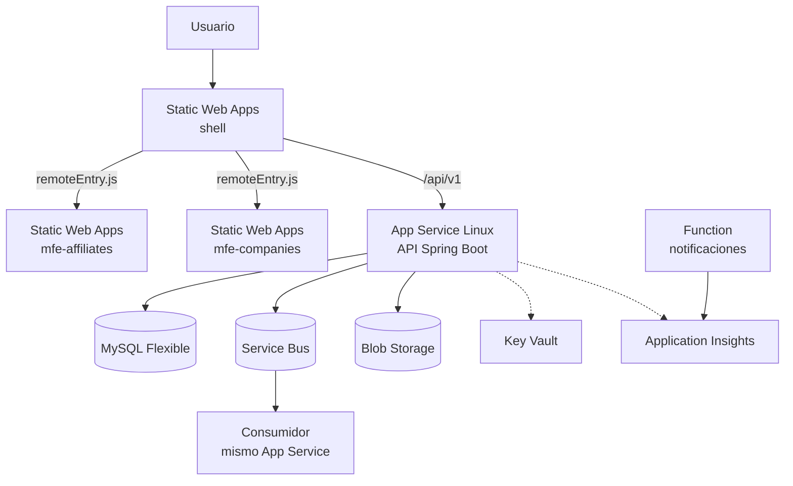

# 12 · Plan de despliegue en Azure: backend y microfrontends

Cómo se publica el prototipo cuando exista: qué artefactos se generan, dónde aterrizan, en qué orden se
promueven y cómo se revierte. El diseño de microfrontends del documento 04 (§4.8) ya decidió tres cosas
que aquí se materializan: **tres aplicaciones independientes**, un **manifiesto de remotos leído en
runtime** y un **`contractVersion` que el shell valida** antes de montar una ruta.

> **Nada de este documento se ha ejecutado.** No hay suscripción, ni `frontend/`, ni `infra/`, ni
> pipeline: la Fase 6 del [plan de entrega](06-plan-entrega.md) es la que los crea. Los nombres de
> recurso y las cifras son de ejemplo, y todo el flujo sigue funcionando en local sin Azure.

## 12.1 Estado actual

| Pieza | Existe hoy | Consecuencia |
|-------|------------|--------------|
| `backend/` | Sí: 92 archivos Java, `pom.xml`, `application.yml` | Comila como proyecto Maven, pero sin migraciones Flyway no arranca contra MySQL |
| `frontend/` | **No existe** | El shell y los dos remotos son diseño, no código |
| `infra/` (Bicep) | **No existe** | No hay infraestructura como código |
| Pipeline | **No existe** | Ningún despliegue automatizado |
| `docker-compose.yml` | **No existe** | El entorno local se levanta a mano |

Por eso este plan es prospectivo: describe el destino y el orden, no un estado alcanzado.

## 12.2 Topología de despliegue



Cuatro artefactos desplegables en tres planos distintos: **estático** (tres Static Web Apps), **cómputo**
(API y Function) y **datos** (MySQL, Service Bus, Blob). Los tres planos se despliegan por separado
porque fallan por razones distintas.

## 12.3 Unidades de despliegue

| Artefacto | Se construye con | Destino | Versionado | Frecuencia |
|-----------|------------------|---------|------------|------------|
| Shell | `ng build shell --configuration production` | Static Web Apps `swa-demo-shell` | Semver propio + manifiesto | Cuando cambia layout, auth o rutas |
| `mfe-affiliates` | `ng build mfe-affiliates` | Static Web Apps `swa-demo-mfe-affiliates` | Semver independiente | Con cada cambio del portal de afiliados |
| `mfe-companies` | `ng build mfe-companies` | Static Web Apps `swa-demo-mfe-companies` | Semver independiente | Con cada cambio del portal de empresas |
| API | `mvn -B verify` → `.jar` | App Service `app-demo-api` (slot `staging` → `production`) | Semver + SHA | Con cada cambio de backend |
| Function | `mvn package` del módulo `azure/functions` | Function App (Flex Consumption) | Semver | Cuando cambia la notificación |
| Esquema | `flyway migrate` | MySQL Flexible Server | `V1`, `V2`, … | Antes del despliegue de la API |
| Infraestructura | `az deployment sub create` (Bicep) | Suscripción / grupo de recursos | Commit SHA | Cuando cambia la topología |

## 12.4 Decisión: tres Static Web Apps, no una

Hay dos formas de publicar tres microfrontends y la elección condiciona todo lo demás.

| Criterio | Una sola Static Web Apps | Tres Static Web Apps (elegida) |
|----------|--------------------------|-------------------------------|
| Pipelines independientes | Difícil: cada deploy reemplaza el contenido completo del sitio | Sí: cada remoto tiene el suyo |
| Radio de impacto de un fallo | Un despliegue malo tumba shell y remotos | Un remoto roto solo afecta a sus rutas |
| Aislamiento de versiones | Se fuerza a publicar los tres a la vez | Cada remoto avanza a su ritmo |
| CORS | Innecesario (mismo origen) | Obligatorio: el shell carga scripts de otro origen |
| Coste | 1 app | 3 apps del plan Free |
| Complejidad operativa | Menor | Mayor: tres configuraciones, tres manifiestos |

**Se eligen tres** porque el objetivo declarado del ejercicio es demostrar despliegue independiente y
aislamiento de fallos, no minimizar el número de recursos. El precio de esa decisión es explícito: CORS,
CSP y caché pasan a ser responsabilidad del equipo, y están resueltos en 12.5.

**Vuelta atrás barata:** si el equipo prefiere un solo host, se cambia el manifiesto a rutas relativas
(`/mfe/affiliates/remoteEntry.js`), se publica un artefacto que contenga las tres compilaciones y se
eliminan dos apps. El código de los remotos no cambia: solo la resolución de URLs.

## 12.5 Configuración de las aplicaciones estáticas

El archivo `staticwebapp.config.json` viaja dentro de cada artefacto. Estos son los dos mínimos viables.

**Shell** — fallback de rutas, CSP y política de referencia:

```json
{
  "navigationFallback": {
    "rewrite": "/index.html",
    "exclude": ["/assets/*", "/*.{js,css,json,ico,svg,woff2}", "/remoteEntry*"]
  },
  "globalHeaders": {
    "X-Content-Type-Options": "nosniff",
    "Referrer-Policy": "strict-origin-when-cross-origin",
    "Content-Security-Policy": "default-src 'self'; connect-src 'self' https://api-demo.azurewebsites.net; script-src 'self' https://swa-demo-mfe-affiliates.azurestaticapps.net https://swa-demo-mfe-companies.azurestaticapps.net; style-src 'self' 'unsafe-inline'; img-src 'self' data:"
  },
  "routes": [
    { "route": "/assets/mf.manifest.json", "headers": { "cache-control": "no-cache, must-revalidate" } }
  ]
}
```

**Cada remoto** — CORS hacia el shell y `remoteEntry.js` sin caché:

```json
{
  "globalHeaders": {
    "Access-Control-Allow-Origin": "https://swa-demo-shell.azurestaticapps.net",
    "Access-Control-Allow-Methods": "GET",
    "X-Content-Type-Options": "nosniff"
  },
  "routes": [
    { "route": "/remoteEntry.js", "headers": { "cache-control": "no-cache, must-revalidate" } },
    { "route": "/remoteEntry.json", "headers": { "cache-control": "no-cache, must-revalidate" } }
  ],
  "navigationFallback": {
    "rewrite": "/index.html",
    "exclude": ["/remoteEntry*", "/*.{js,css,json,ico,svg,woff2}"]
  }
}
```

Tres detalles que rompen microfrontends en producción y no en local:

1. **`navigationFallback` sin exclusiones** devuelve `index.html` cuando falta un chunk; el navegador
   intenta ejecutar HTML como JavaScript y el error que ves es de sintaxis, no un 404.
2. **`remoteEntry.js` cacheado** deja al shell apuntando a chunks de una versión anterior. El
   `remoteEntry` es el único archivo que no debe cachearse; los chunks con hash sí son inmutables.
3. **CSP sin los orígenes de los remotos** bloquea el `script-src` y el síntoma es una pantalla en
   blanco sin error de red.

Sin `Access-Control-Allow-Origin`, el navegador descarta la respuesta del `remoteEntry` y el fallo
aparece como `TypeError: Failed to fetch dynamically imported module`.

## 12.6 Secuencia de despliegue de un remoto

1. **Build reproducible:** `ng build mfe-affiliates --configuration production` con `outputPath`
   `dist/mfe-affiliates`. El artefacto se guarda con el SHA del commit, no con «latest».
2. **Verificación local:** el shell en `ng serve` apunta al `remoteEntry` del build recién generado
   (`ng serve --configuration local-remote`). Se prueba antes de publicar.
3. **Publicación:** `AzureStaticWebApps@1` sube el artefacto a `swa-demo-mfe-affiliates`. El contenido
   se reemplaza de forma atómica: no hay mezcla de versiones a mitad de subida.
4. **Comprobación de contrato:** `curl` al `remoteEntry` + lectura del `Metadata` expuesto; se valida
   `contractVersion` contra el rango que acepta el shell en producción.
5. **Manifiesto:** solo se toca si cambia la URL del remoto o el `contractVersion` mínimo. Un cambio de
   implementación que respeta el contrato **no requiere republicar el shell**.
6. **Humo en producción:** cargar la ruta del portal, comprobar que el remoto monta y que no hay error de
   federación en consola.

**Rollback:** se vuelve a desplegar el artefacto anterior, que el pipeline retiene 30 días, y se revierte
el manifiesto si se había tocado. Tarda lo que tarda una publicación estática (del orden de uno a tres
minutos), **no es instantáneo**: Static Web Apps del plan Free no mantiene versiones activas en paralelo.
Si se exige cambio instantáneo y preproducción simultánea, hace falta el plan Standard o un CDN con dos
orígenes; ninguna de las dos está en el alcance actual.

**Contrato entre shell y remoto:** un remoto puede avanzar en `MINOR`/`PATCH` sin tocar el shell. Un
`MAJOR` obliga a publicar una segunda instancia del remoto en otra URL, cambiar el manifiesto y retirar
la anterior cuando el tráfico confirme. El shell nunca se despliega esperando un contrato que aún no
existe.

## 12.7 Despliegue del backend

**Destino:** App Service Linux, Java 17, plan **Standard S1**. No se usa el nivel gratuito porque su
cuota es de una hora al día y el servicio debe estar disponible; tampoco se usa Container Apps, descartado
en el [documento 10](10-tecnologias-azure.md#109-servicios-evaluados-y-descartados). El plan Standard es el mínimo que
ofrece **deployment slots**, y sin slots no hay promoción con swap.

**Configuración de la aplicación:**

| Ajuste | Valor | Motivo |
|--------|-------|--------|
| `WEBSITES_PORT` | `8080` | Puerto que App Service expone al frontal |
| `JAVA_OPTS` | `-XX:MaxRAMPercentage=75` | Ajusta la JVM al tamaño del plan en vez de a un `-Xmx` fijo |
| `SPRING_PROFILES_ACTIVE` | `prod` | Activa el perfil sin secretos embebidos |
| `DB_URL` | `jdbc:mysql://…:3306/colsubsidio_demo?sslMode=REQUIRED` | TLS obligatorio contra MySQL Flexible |
| `DB_PASSWORD` | `@Microsoft.KeyVault(SecretUri=…)` | Referencia, no valor |
| `APP_MESSAGING_TRANSPORT` | `azure` | Service Bus real |
| `APP_STORAGE_PROVIDER` | `azure` | Blob real |
| `APP_NOTIFICATIONS_PROVIDER` | `azure-function` | Function real |
| `SPRING_FLYWAY_ENABLED` | `false` | Las migraciones las ejecuta el pipeline, no el arranque |
| `APPLICATIONINSIGHTS_CONNECTION_STRING` | Referencia a Key Vault | Telemetría |

**Por qué Flyway se apaga en producción:** con dos o más instancias, cada arranque intenta migrar y
compite por el bloqueo de Flyway; una migración lenta retrasa el arranque y el health check falla. La
migración se ejecuta una vez, como paso previo del pipeline (12.10).

**Secuencia:**

1. `mvn -B verify` (pruebas + JaCoCo) y publicación del `.jar` como artefacto.
2. `az webapp deploy --slot staging` con el `.jar`.
3. Espera a `GET /actuator/health` en `staging` hasta `UP` (máximo 120 s).
4. Smoke test contra `staging` con el mismo contrato de API.
5. `az webapp deployment slot swap --slot staging --target-slot production`.
6. Smoke test contra producción y comprobación de que la versión desplegada es la esperada.

El swap es la razón de pagar Standard: la nueva versión se calienta en `staging` mientras producción
sigue sirviendo, y el cambio de tráfico es un intercambio de DNS interno, no un reinicio.

## 12.8 Orden de despliegue y compatibilidad

| Cambio | Orden | Por qué |
|--------|-------|---------|
| Corrección en un remoto que respeta el contrato | Remoto | El shell no se entera; sin ventana de incompatibilidad |
| Nuevo campo opcional en la API | API primero | El frontend tolera campos que aún no usa |
| Campo obligatorio nuevo o cambio de tipo | API con versión nueva, luego clientes | Nunca romper a un cliente desplegado |
| Nuevo remoto | Shell primero (ruta + manifiesto) | El shell debe conocer la ruta antes de que exista el remoto |
| Retirada de un remoto | Shell primero | Al contrario, el shell pediría un `remoteEntry` que ya no existe |
| Migración de esquema destructiva | Prohibida en un solo paso | Se aplica expandir/contraer en dos despliegues |

**Regla de oro:** ningún despliegue puede dejar al sistema en un estado donde una versión desplegada
llame a un contrato que no existe. Es la misma regla que se pide para el bus de eventos, aplicada al
frontend.

## 12.9 Identidad y secretos

- **Azure DevOps → Azure:** federación de identidad de carga de trabajo (OIDC). Sin secretos de service
  principal en el pipeline ni caducidad manual.
- **App Service → Key Vault:** identidad administrada asignada al recurso; rol *Key Vault Secrets User*.
  La configuración usa referencias `@Microsoft.KeyVault(...)`, así que rotar un secreto no obliga a
  redesplegar.
- **App Service → Blob:** *Storage Blob Data Contributor* sobre el contenedor de evidencias, no la clave
  de la cuenta.
- **Consumidor → Service Bus:** *Azure Service Bus Data Receiver* en la cola; el publicador usa
  *Data Sender*. Roles separados: el consumidor no puede publicar.
- **Nada de secretos en el repositorio.** El `.env` local está en `.gitignore` y el pipeline no imprime
  variables.

## 12.10 Base de datos en el pipeline

La migración es un paso propio, con identidad propia:

1. Paso `FlywayMigrate` con el usuario de migración (DDL) y `flyway.url` apuntando al servidor real.
2. `flyway info` para dejar en el log qué versión había y qué versión queda.
3. Solo si la migración termina en `Success` se despliega la API.

Reglas para que el despliegue sea reversible:

- **Expandir/contraer:** primero se añade la columna o tabla nueva (compatible con la versión anterior),
  después se despliega el código que la usa, y en un despliegue posterior se elimina lo viejo.
- **Nunca** `DROP COLUMN` en la misma entrega que deja de usarla.
- Migraciones idempotentes donde sea posible (`CREATE TABLE IF NOT EXISTS`) para que un reintento no
  deje el esquema a medias.
- El script de reversión es una migración nueva hacia adelante, no `flyway undo` (solo disponible en la
  edición de pago).

## 12.11 Pipeline en Azure DevOps

Un solo pipeline con etapas encadenadas y puertas entre ellas. Extracto de la estructura, no el archivo
completo:

```yaml
trigger:
  branches: { include: [main] }
  paths: { include: [backend/*, frontend/*, infra/*] }

variables:
  - group: colsubsidio-demo-nonprod   # sin secretos: solo nombres de recursos

stages:
  - stage: Build
    jobs:
      - job: Backend
        steps:
          - task: Maven@4
            inputs: { goals: 'verify', publishJUnitResults: true }
          - publish: backend/target
            artifact: api
      - job: Frontend
        steps:
          - script: npm ci && npm run build:all
            workingDirectory: frontend
          - publish: frontend/dist
            artifact: frontend

  - stage: Migrate
    dependsOn: Build
    jobs:
      - deployment: Flyway
        environment: colsubsidio-demo-prod   # habilita la aprobación manual
        strategy:
          runOnce:
            deploy:
              steps:
                - script: mvn -B flyway:migrate -Dflyway.url=$(DB_URL) -Dflyway.user=$(DB_MIGRATION_USER)
                  env:
                    FLYWAY_PASSWORD: $(DB_MIGRATION_PASSWORD)

  - stage: DeployApi
    dependsOn: Migrate
    jobs:
      - deployment: Api
        environment: colsubsidio-demo-prod
        strategy:
          runOnce:
            deploy:
              steps:
                - task: AzureWebApp@1
                  inputs:
                    appName: app-demo-api
                    slotName: staging
                    package: $(Pipeline.Workspace)/api/*.jar
                - script: curl -f --retry 12 --retry-delay 10 https://app-demo-api-staging.azurewebsites.net/actuator/health
                - task: AzureAppServiceManage@0
                  inputs:
                    action: Swap Slots
                    sourceSlot: staging
                    targetSlot: production

  - stage: DeployFrontend
    dependsOn: DeployApi
    jobs:
      - deployment: Shell
        environment: colsubsidio-demo-prod
        strategy:
          runOnce:
            deploy:
              steps:
                - task: AzureStaticWebApp@0
                  inputs:
                    app_location: frontend/dist/shell
                    azure_static_web_apps_api_token: $(SWA_SHELL_TOKEN)
      - deployment: Remotes
        dependsOn: Shell
        strategy:
          runOnce:
            deploy:
              steps:
                - task: AzureStaticWebApp@0
                  inputs:
                    app_location: frontend/dist/mfe-affiliates
                    azure_static_web_apps_api_token: $(SWA_MFE_AFFILIATES_TOKEN)
                - task: AzureStaticWebApp@0
                  inputs:
                    app_location: frontend/dist/mfe-companies
                    azure_static_web_apps_api_token: $(SWA_MFE_COMPANIES_TOKEN)
```

**Puertas:** la etapa `Migrate` y la `DeployApi` usan un `environment` con aprobación, de modo que la
migración de esquema nunca se ejecuta sola. Los tokens de Static Web Apps son secretos de pipeline y se
rotan desde el portal.

**Smoke tests después del despliegue:** Playwright contra la URL de producción con tres comprobaciones
mínimas —el shell carga, la ruta del remoto monta y no aparece `Failed to fetch dynamically imported
module` en consola—. Un despliegue que compila pero rompe la federación no cuenta como verde.

## 12.12 Ambientes y promoción

| Ambiente | Frontend | Backend | Datos | Propósito |
|----------|----------|---------|-------|-----------|
| Local | `ng serve` en 4200 / 4201 / 4202 | `spring-boot:run` en 8080 | MySQL en contenedor (o H2) | Desarrollo y demo sin Azure |
| Staging | Build servido localmente o app de preproducción | Slot `staging` | Misma base, datos sintéticos | Validar antes del swap |
| Producción | Tres Static Web Apps | Slot `production` | MySQL Flexible + Blob + Service Bus | Demo desplegada |

La promoción es **el mismo artefacto**: no se recompila entre ambientes. Lo único que cambia es la
configuración (`DB_URL`, orígenes del manifiesto, cadenas de Application Insights).

## 12.13 Coste y free tier del despliegue

| Pieza | Free tier | Nota |
|-------|-----------|------|
| Static Web Apps × 3 | Sí, plan Free | 100 GB de banda al mes **por suscripción**, compartidos por las tres apps; 0,5 GB por app; sin SLA |
| Azure Functions | Sí, permanente | 1 000 000 de ejecuciones y 400 000 GB-s al mes |
| Application Insights | Parcial | 5 GB de ingesta al mes por cuenta de facturación |
| App Service (API) | **No sirve** | El nivel gratuito da 1 hora al día; se requiere Standard para slots y disponibilidad |
| MySQL Flexible | Solo 12 meses | 750 h B1MS y 32 GB en cuentas nuevas; después, pago por uso |
| Service Bus | No | Se paga por operaciones |
| Blob Storage | No | Se paga por GB y operaciones |
| Key Vault | No | Se paga por operaciones |

Traducción práctica: **el frontend puede vivir en free tier; el backend no.** Publicar la API y la base
es el coste real del despliegue, y es la razón por la que el requisito de «corre en local sin Azure» está
en el centro del ejercicio: la demo se puede evaluar completa sin gastar.

## 12.14 Riesgos de despliegue

| Riesgo | Síntoma | Mitigación |
|--------|---------|------------|
| `navigationFallback` captura assets | `Failed to fetch dynamically imported module` | Excluir `*.js`, `*.json` y `remoteEntry*` del fallback |
| CORS mal configurado en el remoto | El `remoteEntry` no carga solo en producción | `Access-Control-Allow-Origin` con el origen exacto del shell, sin comodín |
| `remoteEntry.js` cacheado | El shell mezcla chunks de dos versiones | `no-cache` solo en `remoteEntry`; chunks con hash e inmutables |
| Desfase de contrato | El shell monta una ruta con un DTO que cambió | `contractVersion` validado antes de montar; `MAJOR` obliga a nueva URL |
| Migración destructiva | La versión anterior falla durante el swap | Expandir/contraer en dos despliegues |
| Flyway en el arranque | Reinicios compitiendo por el bloqueo | `spring.flyway.enabled=false` en producción |
| Una sola instancia en producción | El swap o un reinicio deja sin servicio | Mínimo dos instancias en el plan Standard |
| Límite de 100 GB de banda | El sitio deja de servirse hasta el siguiente ciclo | Presupuesto de imágenes y compresión; vigilar la métrica |
| Sin SLA en plan Free | Caída sin compromiso contractual | Aceptado para una demo; documentado como límite |

## 12.15 Qué falta para ejecutar este plan

| Pendiente | Bloquea |
|-----------|---------|
| `frontend/` con shell y dos remotos | Todo el plano estático |
| `infra/` con Bicep (SWA × 3, App Service, MySQL, Service Bus, Blob, Key Vault, Function) | Cualquier despliegue reproducible |
| `docker-compose.yml` | La paridad local que este plan promete |
| Migraciones Flyway `V1`–`V3` | La etapa `Migrate` |
| `azure-pipelines.yml` y los tres tokens de Static Web Apps | La automatización |
| Pruebas E2E de humo | La puerta de calidad posterior al despliegue |

Todo ello corresponde a la Fase 6 del [plan de entrega](06-plan-entrega.md), con la salvedad de que los
microfrontends se construyen en la Fase 4 y las migraciones en la Fase 2: este documento describe cómo se
publican, no cuándo se escriben.
